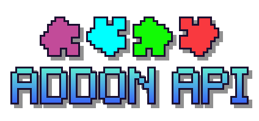

# Addon API 3.0

{ .mf-page-logo }

Making a mod and want it to know when someone just cleared a song - or start a MineFunkin fight yourself? The Addon
API lets **other mods react to what happens in MineFunkin** and **use MineFunkin as a tool**: a song was played to the
end, a fight is over, a player hit a note - and your boss mob can start a fight against the player who hit it, pause it,
change the player's health and get the result back. A progression mod could hand out XP for a cleared song, a server mod
could forbid fights in the Nether, a HUD mod could show your combo.

This part is for mod developers (Java). If you want to change what happens *inside* a song - flashes, lanes, the
camera - you're looking for [event scripts](../guides/index.md), no Java needed.

## What you can build

| Idea | Side | With |
|---|---|---|
| XP, money or items for a cleared song | server | [`onSongCompleted`](server.md#events) |
| An achievement for the first full combo (SFC / GFC / FC) on a song | server | [`onRankImproved`](server.md#events) |
| No fights in the Nether, at spawn, during a minigame | server | [`allowFight`](server.md#fights) |
| A prize for the winner of a fight | server | [`onFightEnded`](server.md#fights) |
| A chat message when two players start a fight | server | [`onFightStarted`](server.md#events) |
| A list of the best players on a song | server | [`songs().leaderboard`](server.md#queries) |
| A boss that starts a fight when you hit it, and drops loot when you win | server | [`fights().start`](starting-fights.md) |
| Your mob as the boss - its own model, its own moves, a boss bar | server + resources | [`Opponent.entity`](boss-opponents.md) |
| A cutscene in the middle of a fight, damage from the boss | server | [`pause`, `addHealth`](controlling-fights.md) |
| Your own leaderboard ("Fastest boss kills") | server | [`Board.own`](starting-fights.md#leaderboards) |
| A scoreboard of a running fight | server | [`fight.fighters()`](controlling-fights.md#reading-a-fight) |
| A sound or a particle on every "Sick!" | client | [`onNoteJudged`](client.md#events) |
| Your own combo or accuracy display | client | [`currentRun()`](client.md#queries) |
| "Playing Bopeebo (Hard)" in a status or presence mod | client | [`onSongStarted`](client.md#events) |

Complete code for these is on [Recipes](recipes.md).

## How it works

1. **Your mod asks for the API.** One line in your mod's metadata file and one small class (see
   [Set up your mod](setup.md)).
2. **MineFunkin hands your class a handle** while the game starts: an object called `api` that belongs
   to your mod.
3. **You tell the handle what you want to hear about:** `api.events().onSongCompleted(...)`. From
   then on MineFunkin calls your code every time that happens.
4. **Changing things needs a right** your mod lists in the same metadata file - starting fights, controlling them. The
   server's admin can take any of them away (see [Rights](rights.md)).

The API is **opt-in**: if no installed mod asks for it, it stays completely off - no events fire, nothing is
recorded for it, it costs the game nothing. And your mod doesn't *need* MineFunkin either: without it, your addon class
is simply never loaded, and the rest of your mod works as usual.

It's the same API on both builds of MineFunkin - **Fabric 1.21.11** and **NeoForge 1.21.1**: the same
types, the same events, the same queries. Only the way your mod asks for it differs.

## Server side or client side?

| | [Server side](server.md) | [Client side](client.md) |
|---|---|---|
| Runs on | the server (in singleplayer: the built-in one) | each player's own game |
| Knows about | results that count, every fight, who practices, the leaderboard | the local player's own runs, live and note by note - practice included |
| Can change | start fights, control your own fights (with [rights](rights.md)) | nothing |
| Can it be trusted? | yes - results say whether the server checked them | no - it's the player's own game |
| Use it for | rewards, rules, ranks, announcements | HUDs, sounds, statistics, presence |

A mod can use both: one class for each side.

## Words used here

| Word | Meaning |
|---|---|
| **handle** | The `api` object your class gets. Everything goes through it. |
| **listener** | A piece of your code that MineFunkin calls when something happens (a Java lambda). |
| **event** | The something: a song completed, a note judged, a fight ended. |
| **run** | One play of a song, from the end of the countdown to its end. A restart is a new run. |
| **chart**, **song key** | One song + character + difficulty, played on one side. `SongRef.key()` is the text MineFunkin stores scores, leaderboards and replays under (each side its own) - use it for your own per-chart data too. |
| **practice**, **dummy fight**, **player fight** | The three ways to play: at the Retro TV (counts for nothing), against the dummy, against another player - at a Speaker, or wherever an addon starts the fight. |
| **right** | Something your mod may change - starting a fight, pausing its own. Listed in your mod's metadata, the server's admin can take it away. |
| **your fight** | A fight your addon started. Only you control it; everyone can read it. |
| **stage figure** | A mob's model that fights in its place when your fight is against a mob ([Boss opponents](boss-opponents.md)). |
| **verified** | The server checked the numbers itself (see [Can I trust a result?](server.md#can-i-trust-a-result)). |
| **server thread**, **render thread** | Where your listener runs: the game's main threads. Keep listeners quick. |

## Where to next

| | |
|---|---|
| [Set up your mod](setup.md) | step by step: compile against MineFunkin, ask for the API, see it work |
| [Recipes](recipes.md) | complete, small addons to copy |
| [Server side](server.md), [Client side](client.md) | every event and query |
| [Rights](rights.md) | what your mod may change, what the server's admin decides |
| [Starting fights](starting-fights.md), [Controlling fights](controlling-fights.md) | your own fights: the kit, the result, pause, stop, health |
| [Boss opponents](boss-opponents.md) | a mob as the boss: its figure, its animations (also from Blockbench), the boss bar |
| [Types](types.md) | every record and enum, field by field |
| [Versions and loaders](versions.md) | detecting the version, what changed since 2.0, Fabric and NeoForge |
