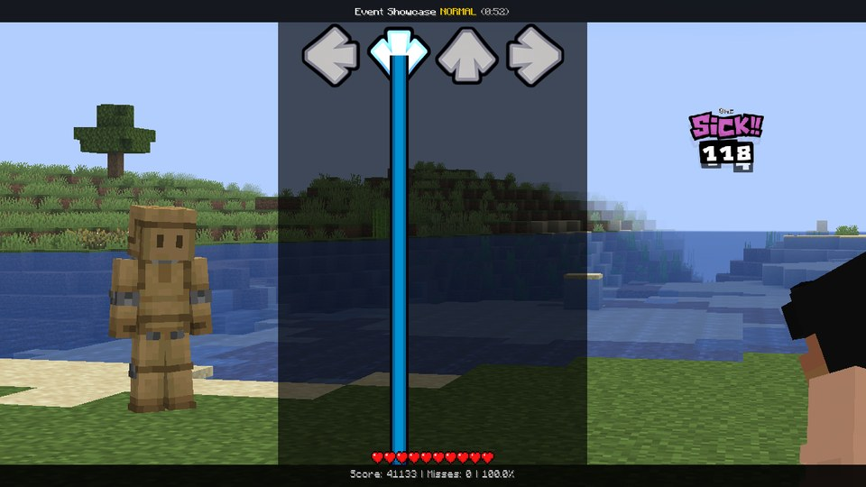
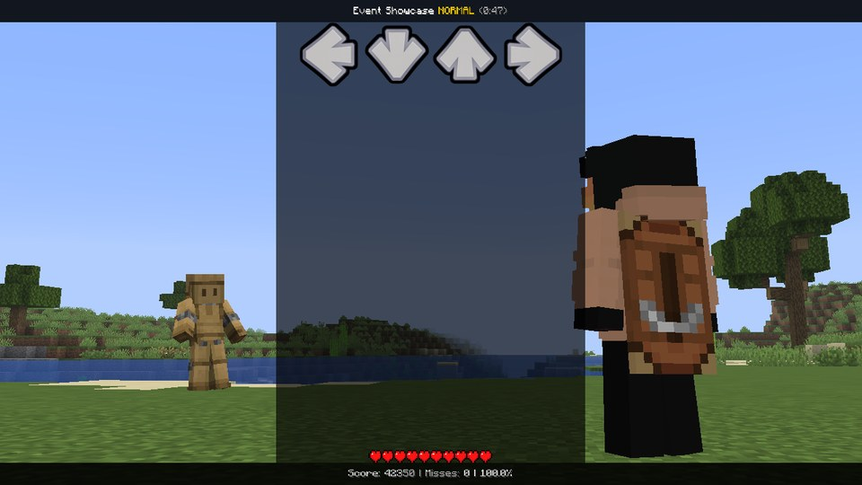

# The fight camera

In a fight - at a Speaker, against the dummy or a real player - you watch the world through MineFunkin's fight
camera. It stands just behind your fighter, with the opponent out ahead, and it's been tuned to frame the two of you
nicely. Your scripts get to move it on top of that picture: lean over, push in, swing round, tilt for drama.

Practice at the Retro TV has no world, so there the camera properties simply do nothing. Nothing breaks - they're
just ignored.


Eight properties move it: [`camera.x`, `.y`, `.z`](../api/camera.md#camera-x) (in blocks),
[`.yaw`, `.pitch`, `.roll`](../api/camera.md#camera-yaw) (in degrees), [`.fov`](../api/camera.md#camera-fov) (the
lens) and [`.nudge`](../api/camera.md#camera-nudge) (how much it follows your hits). Defaults, ranges and the details
are on the [camera](../api/camera.md) page.

One thing worth knowing before you start: "right" and "forward" belong to the *fight*, not to wherever the camera is
looking right now. Forward is the way the camera looks when it's at home. So `camera.z = 2` always moves towards the
fight, however far you've turned `camera.yaw`. That makes moves much easier to combine.

`camera.zoom`, `camera.bump` and `camera.shake` work in fights too - the zoom and the beat pop zoom the world along
with the HUD.

## The quick way: `focus`

A camera that drifts over to whoever's singing takes one line:

```lua
focus("opponent")            -- lean towards the opponent (over one beat)
focus("player", beats(2))    -- towards you, over two beats
focus("center")              -- back to the middle
focus("dad")                 -- towards whoever plays the opponent part, wherever they stand
```

`focus` moves `camera.x`, `camera.z` and `camera.yaw` a little - just a lean, not a jump. Pair it with `song.singer`
and the camera follows the song by itself:

```lua
function onBeat(b)
    if song.singer == "opponent" then
        focus("opponent")
    elseif song.singer == "player" then
        focus("player")
    end
end
```

## Calming it down: `camera.nudge`

On every hit, the fight camera pans a tiny bit towards the note's direction. It makes playing feel punchy, but it
also gets in the way of your own camera moves. `camera.nudge = 0` switches it off - for a calm part, or while your
script is steering. `camera.nudge = 2` makes it twice as strong, if you want more punch.

## Putting it back

Whatever you did, there's a way home:

```lua
resetCamera()                          -- at once
resetCamera(beats(2))                  -- gliding home over two beats
reset(camera, beats(1), "backOut")     -- the same, with an easing of your choice
```

`resetCamera` resets everything above (`camera.nudge` too), plus `camera.zoom` and `camera.shake`. And when the song
ends, the camera goes home on its own - you can't leave anybody stuck in a weird angle.

## Recipes

**Look over at the opponent.** They stand ahead and to the left, so turn left a little and narrow the lens:

```lua
tween(camera.yaw, -6, beats(1), "sineInOut")
tween(camera.fov, -8, beats(1), "sineInOut")
```



**From down low.** Drop the camera, tilt it up, widen the lens - everybody looks taller and more dramatic:

```lua
camera.y = -1.2
camera.pitch = 12
camera.fov = 10
```



**A slow push in**, for a tense moment:

```lua
tween(camera.z, 1.5, beats(8), "sineInOut")
tween(camera.fov, -6, beats(8), "sineInOut")
```

**A handheld camera** that drifts around without ever jittering (that's what `noise` is for):

```lua
function onFrame(dt)
    camera.yaw = noise(time / 900) * 1.5
    camera.pitch = noise(time / 1100 + 40) * 1
    camera.roll = noise(time / 1300 + 80) * 1
end
```

**A Dutch angle on every beat:**

```lua
local side = 1

function onBeat(b)
    side = -side
    tween(camera.roll, side * 6, beats(0.5), "backOut")
end
```

**Circling the fighters.** If you only turn the camera, the fighters slide out of the picture. Move and turn together,
and a point stays right in the middle. For a point `d` blocks straight ahead, turning by `a` degrees means moving to
`x = -d * sin(a)`, `z = d * (1 - cos(a))`:

```lua
local function orbit(angle, d)
    local a = angle * pi / 180
    camera.yaw = angle
    camera.x = -d * sin(a)
    camera.z = d * (1 - cos(a))
end
```

Swing it round the point between the fighters - pulling back and rising a little as it goes - and both of them stay
in view:


!!! tip "Which way to swing"
    Your fighter stands close to the camera. Swing towards the side where the opponent ends up *behind* your fighter
    (with the default layout: negative angles, around -25°) and the opponent vanishes behind your back. Swing the
    other way, and you see both side by side.

## Good to know

- The camera only moves in *your* picture. The other fighter and everyone watching see their own.
- Walls behind your fighter are still hidden (the camera looks past them), with or without your scripts.
- Shader packs (Iris) work with a moved camera like with any other.
- Players with **Less motion** switched on (Options › MineFunkin › Accessibility) get no nudge on hits, no beat pop and
  no shake. Your other camera moves still play - so make sure the song still reads well without the shaking.
