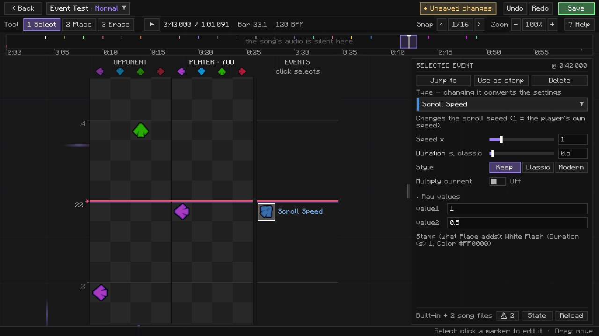
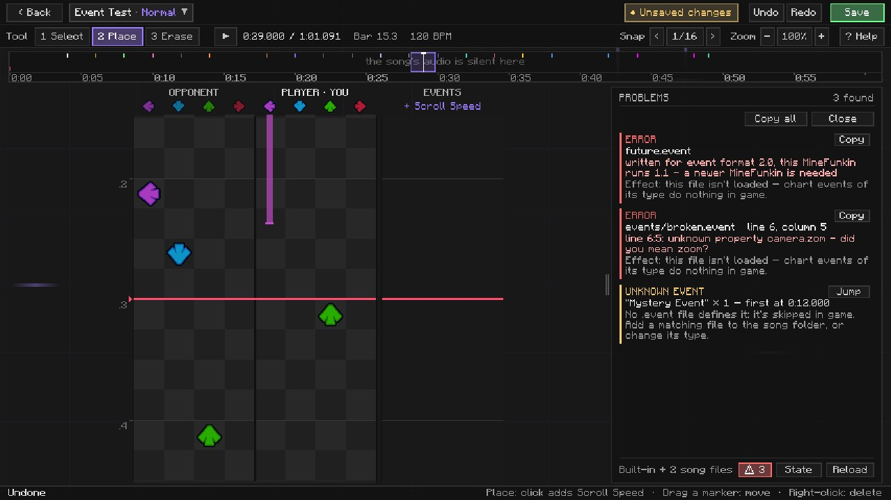
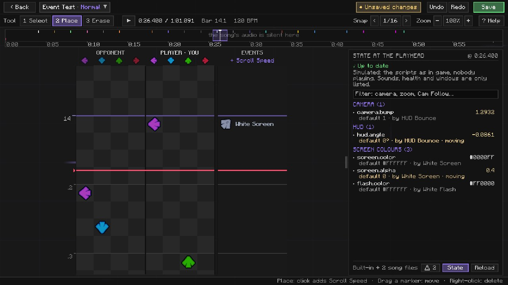

# In the chart editor

The chart editor is where your events meet the song. Open it at a Retro TV (› Editor), pick a song, and you're in.

Here's the nice bit: you never have to tell the editor about your events. It reads everything from the event's own
file - the name, the colour, the category, the description, and the controls for its
[parameters](../api/parameters.md). Write a file, press Reload, and it's there.

The first time you open the editor, a short help pops up with the basics. You can get it back any time with
**? Help** in the tool bar.

## Finding your way around

| Part | What it's for |
|---|---|
| Document bar (top) | Back, the song and difficulty (its menu lets you switch difficulty, copy events from another difficulty, or add a new one), whether you have unsaved changes, Undo, Redo, Save. |
| Tool bar | The tool (Select / Place / Erase), play / pause and the time, bar.beat and the BPM, the snap, the zoom, ? Help. |
| Overview strip | The whole song at a glance: its waveform, every event as a tick, BPM changes, and the box showing what the grid shows right now. Click or drag to jump; hover to see the time. |
| Grid | The bar ruler, the opponent's lanes, your lanes, and the **EVENTS** lane: four cells wide, with a single marker's name written next to it, and "+N" when a row holds more than fits. |
| Inspector (right) | Whatever you've selected - an event, a BPM change, notes - or the **stamp** (the next event you'll place). Too narrow? Drag its left edge. |
| Footer | The song's event files, **⚠ N** (files that can't be used, unknown events), **State**, **Reload**. |
| Status line (bottom) | The keys for whatever the mouse is over, and what just happened. |

## The three tools

| Tool | Key | Click on an empty cell | Click on something |
|---|---|---|---|
| **Select** | 1 | lets go of the selection | selects it |
| **Place** | 2 | a note (note lanes) or the stamp's event (EVENTS lane); drag down for a hold | selects it |
| **Erase** | 3 | - | deletes it (drag to delete several) |

A right-click deletes, whatever tool you're holding. And with Place, you see a ghost of the next note or event before
you click, so there are no surprises.

## Placing and editing events

1. With nothing selected, the inspector shows the **stamp** - the event Place will add. Pick its type: the picker
   searches names, categories and descriptions, can show only built-in events or only this song's, and tells you what
   the hovered one does right beside the list.
2. Set its parameters.
3. Take the **Place** tool and click the EVENTS lane where it should happen. Changed your mind? Drag the marker.

Click an event to select it, and the inspector shows it as **SELECTED EVENT**: its parameters as controls, plus
**Jump to**, **Use as stamp** and **Delete**. Every change goes straight back into the event's value1 and value2, and
each one is a single undo step (dragging a slider counts once, when you let go).

Selecting an event leaves your stamp alone - if you *want* to place more of the same, press **Use as stamp**. And if
you change a selected event's type, its settings are converted: whatever both types share is kept, the rest starts at
its default.

Colour settings have a swatch - click it for a row of colours (and "not set"). A setting that isn't at its default is
drawn brighter, so you can see at a glance what you changed. Hover a setting's name for its kind, range and default.

**Raw values**, folded away at the bottom of the event view, shows value1 and value2 as plain text. That's the Psych
Engine format, and it's what ends up in the chart file. An event without a file behind it (from a converted chart, or a
file you deleted) shows up grey with just its raw values. Don't worry - it's kept and saved exactly as it was.

## When something's wrong

**⚠ N** in the footer opens a list of everything that doesn't work:

- **Errors** - a song file that can't be used, with the line, the column, the message, and what that means in the game.
- **Warnings** - a file that broke after it had worked. The editor keeps using the last working version until you fix
  it, so your song doesn't fall apart while you type.
- **Unknown events** - chart events that no file answers to, how often they're in the chart, and **Jump** to the next
  one.

**Copy** puts a message on the clipboard (handy when you ask someone for help). **Reload** reads the song folder
again: change a file in your text editor, save, press Reload. Everything here also goes into
`logs/minefunkin-events.log`.

## State: what your scripts did up to here

Ever wondered *why* the HUD is upside down at bar 40? **State** in the footer answers that. It runs the song's scripts
from the start up to the playhead - just like the game would, only nobody's playing - and lists every property that
isn't at its default there, grouped (CAMERA, HUD, LANES, ...).

Click a row to see which event set it, the tween that's moving it, and what other events wrote under it. The filter
field narrows the list down. Pause somewhere else and it works it all out again. Things it can't show (sounds, health,
the window) are listed at the end.

It's the same answer [`inspect`](../api/shortcuts.md#inspect) writes to the log during a song.

## Saving

**Save** (or Ctrl+S) writes the chart. The bar tells you whether you have unsaved changes, that it saved, or that
saving failed (hover it to see why). If you press Back, switch difficulty or add one with unsaved changes, the editor
asks once: save and go on, throw the changes away, or stay.

Editing a server's song also sends it to the server. The status line tells you whether that got going - the server
doesn't answer back, so the editor won't pretend to know more than that.

## Keys

| Key | |
|---|---|
| 1 / 2 / 3 | Select / Place / Erase |
| Space | play / pause |
| ← / → | step back / forward (on a focused slider: change it) |
| `[` / `]` | coarser / finer snap |
| Ctrl+Z / Ctrl+Y | undo / redo |
| Ctrl+S | save |
| Ctrl+wheel | zoom the grid |
| Tab / Shift+Tab | move between controls; Enter presses |
| Esc | close a popup, then the problems / state panel, then clear the selection, then leave the editor |

In the note lanes: drag to select, drag down while placing to make a hold, hold Alt to place between the snap cells.
With notes selected: drag to move them, drag a tail to change the hold, H marks a forced miss, Ctrl+C / Ctrl+V copy and
paste at the playhead.
