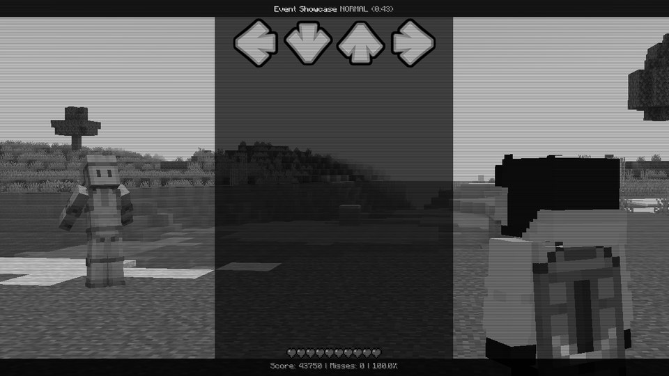
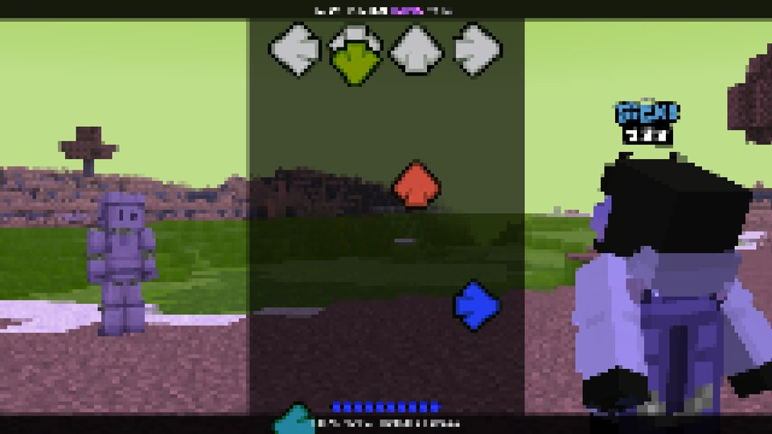
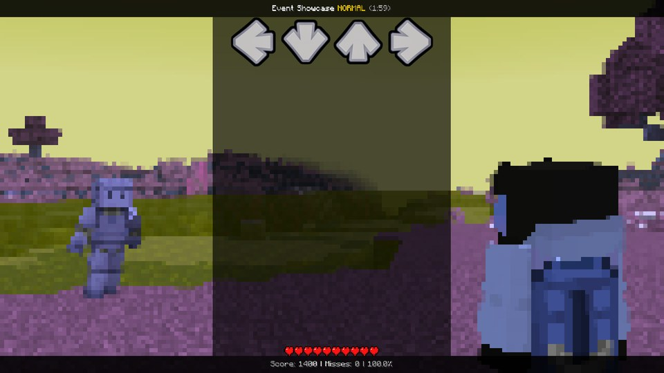
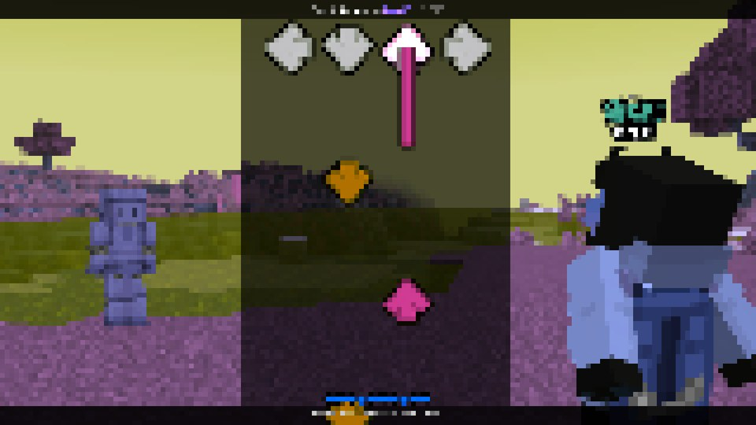
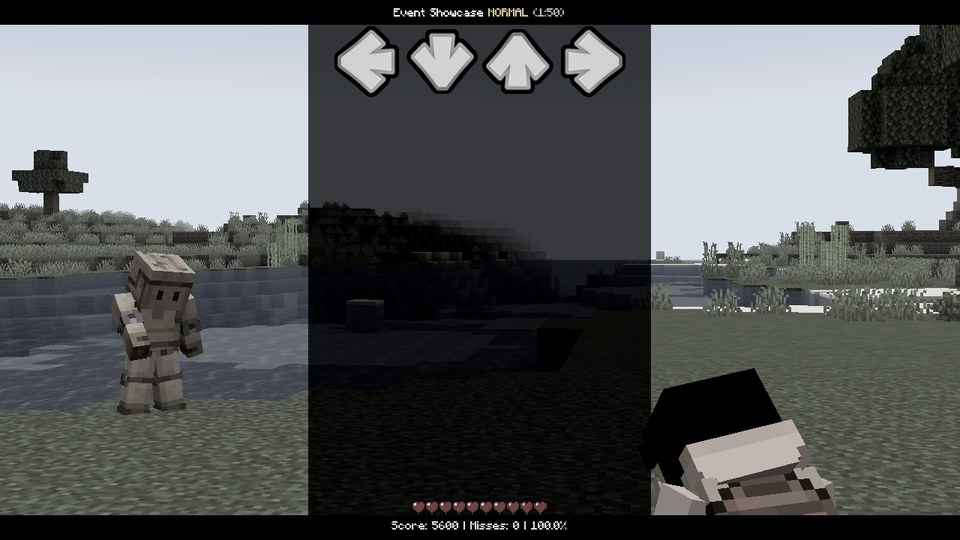

# Effects (`fx`)

Sometimes a song needs the whole picture to change: the colour drains out on a sad part, the screen glitches when the
villain shows up, everything goes pixelated on the drop. That's what `fx` is for - built-in effects laid over the
picture, no shader writing needed.

There are sixteen of them: `grayscale`, `sepia`, `invert`, `hue`, `saturation`, `contrast`, `brightness`, `chromatic`,
`blur`, `pixelate`, `wave`, `glitch`, `scanlines`, `grain`, `bulge` and `bloom`, plus `fx.target` to choose what they
cover. What each number means is on [fx](../api/fx.md).

They only run while the song plays - never over the pause menu or the results, so nobody has to read a menu through a
glitch. And they're all off by default. While none is on, nothing is computed at all, so they cost you nothing until
you use them.

<div class="grid" markdown>





</div>

## Screen, world or terrain

This is the clever part: you decide *what* gets the effect.

| `fx.target` | What gets the effect |
|---|---|
| `"screen"` (default) | **everything**: the world, the HUD, the strumline, your texts and pictures |
| `"world"` | only the world - the notes and the HUD stay sharp, so even a heavy effect stays playable |
| `"terrain"` | the world *without the two fighters*: everything around them changes, they stay as they are |

`"world"` and `"terrain"` need a fight. Practice at the Retro TV has no world, so there they do nothing.

<div class="grid" markdown>





</div>

*The same `fx.pixelate = 8`, `fx.hue = 150` twice. Left, `"world"`: the arrows and the score stay crisp. Right,
`"screen"`: everything gets pixelated.*

```lua
-- The world turns into an old photo, the two of you stay in colour.
function onEvent(p)
    fx.target = "terrain"
    tween(fx.sepia, 1, beats(2), "sineInOut")
end
```

With `"terrain"`, anything that stands in front of a fighter (a block, an arrow) gets the effect like the rest of the
world - only the fighters themselves are spared, with their armour, cape and shadow. One small catch: they're drawn
over the finished world, so while a `"terrain"` effect runs, rain and particles don't show in front of them, and water
in front of a fighter hides it.

## Switching off

When the moment's over:

```lua
resetFx()            -- everything off at once, the target back to "screen"
resetFx(beats(1))    -- fades out (the target stays until it's gone)
```

Your [own shaders](shaders.md) count too: `resetFx` switches them off as well. And when the song ends, everything
goes off by itself.

## Recipes

**A punch on every miss.** The colour drains and the picture splits for a moment - the player *feels* that miss:

```lua
function onMiss(note)
    fx.chromatic = 8
    fx.saturation = 0
    tween(fx.chromatic, 0, beats(0.5), "quadOut")
    tween(fx.saturation, 1, beats(0.5), "quadOut")
end
```

**An old tape** that never quite sits still:

```lua
local active = false

function onEvent(p)
    active = true
    fx.scanlines = 0.7
    fx.grain = 0.35
    fx.sepia = 0.3
end

function onFrame(dt)
    if not active then return end
    fx.wave = 1 + 2.5 * abs(noise(time / 700))
end
```

**A glitch burst** for half a beat, for when something goes very wrong:

```lua
fx.glitch = 1
fx.chromatic = 10
fx.pixelate = 6
tween(fx.glitch, 0, beats(0.5), "quadIn")
tween(fx.chromatic, 0, beats(0.5), "quadOut")
tween(fx.pixelate, 0, beats(0.5), "expoOut")
```

**Drained of colour**, and back again:

```lua
tween(fx.saturation, 0.15, beats(2))
tween(fx.contrast, 1.25, beats(2))
-- later:
tween(fx.saturation, 1, beats(1))
tween(fx.contrast, 1, beats(1))
```



**Colours walking round the wheel**, slowly, forever:

```lua
function onFrame(dt)
    fx.hue += 40 * dt / beats(1)   -- 40 degrees per beat
end
```

## Good to know

- MineFunkin draws the effects itself, on top of Minecraft's own picture. So they get along fine with shader packs
  (Iris): the pack draws the world, your effects go on top.
- The order: your own shaders by slot, then the built-in effects. With several targets in use, `"terrain"` comes
  first, then `"world"`, then `"screen"` - each one works on what the one before it left behind.
- Players with **Fewer flashes** switched on (Options › MineFunkin › Accessibility) get `invert` and `glitch` at 0.3 at
  most and `brightness` at 1.3 at most. The rest of your effect stays as it is.
- Heavy effects over the notes (pixelate, wave, glitch, blur) make a song really hard to read. Keep them short, put
  them where the player has a break - or just use `"world"`, which leaves the notes alone.
