# The fighters

The two fighters are the stars of every song - so of course you can play with them. Move them, turn them, squash
them like jelly, paint them red, make one three times taller, swap their places mid-song, or take over their animation
completely and choreograph your own dance.

`player` is you (the one the camera looks over), `opponent` is the other one. `puppet[0]` and `puppet[1]` are the same
two by number, which comes in handy in loops and functions.

Here's the important bit: all of this happens **only in your own picture**. The real players don't move an inch, and
nobody else (your opponent, the people watching) sees it. That's what makes it safe to go wild. The one exception is
poses a song designs with [setPose](#your-own-poses-setpose) - those, the players standing around see too.

**In practice** (the Retro TV) there's no world, but the two puppets next to the lanes follow most of it: position,
size, squash, turn, tint, poses, body parts, pinning and skins. Outlines, clipping, `depth` and `facing` only work in
fights.

There's also `boyfriend` and `dad`: the same two fighters, but named by the **chart's** sides - see
[Places](#places-bind) and [fighter names](../api/choices.md#fighter-names).

## The whole fighter

Both fighters have the same set of properties - position and turn (in blocks and degrees), `scale`, `squash`,
`color`, `alpha`, `visible`, `animate`, `pose`, `skin`, `model`, the pinning ones, outlines and clipping. Every one of
them, with defaults and ranges, is on [Fighters](../api/fighters.md). What works for `player.` works the same for
`opponent.` and `puppet[i].`.

<div class="grid" markdown>

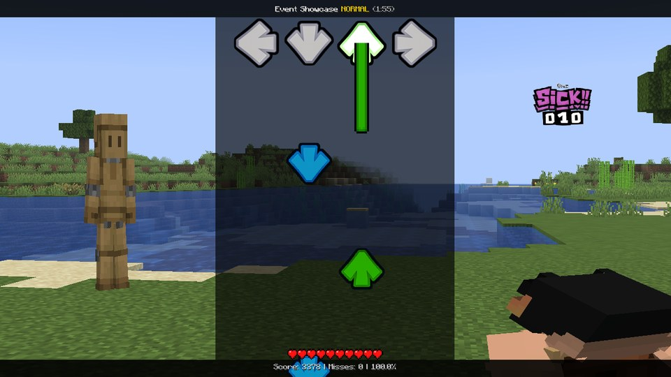

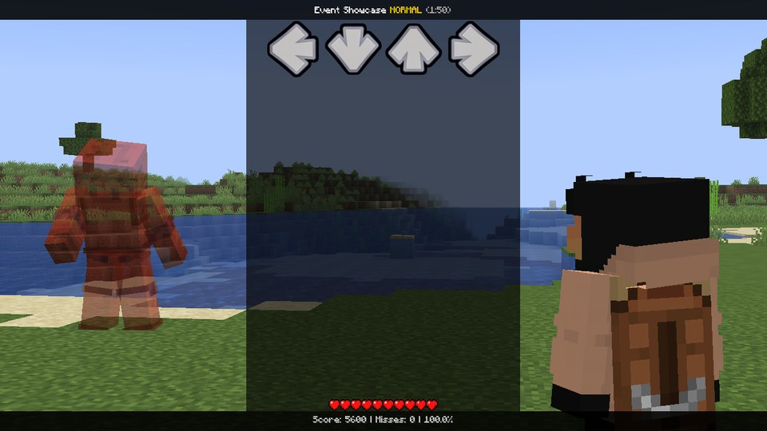

</div>

*Left: `player.squash = 0.4`, `opponent.squash = -0.45`. Right: `opponent.color = #FF5050`,
`.alpha = 0.55`, `.scale = 1.5`, `.turn = 40`.*

For the common moves there are one-liners: `swapFighters()`, `pose("opponent", "up")`,
`setSkin("player", "skins/bf.png")`, `setModel("both", "slim")` - see [Shortcuts](../api/shortcuts.md#fighters).

## Pinned to the screen

In Psych, characters are sprites: you put them somewhere on the screen and that's where they are. A MineFunkin
fighter normally stands where the fight puts it, and the camera looks at it. **Pin** it, and it behaves like a sprite
instead: it stays on its spot on the screen, whatever the camera does.

- `screenX` / `screenY` say where its **feet** are: `0.5, 0.9` = in the middle, near the bottom.
  Below 0 or above 1 is off the screen - that's how you slide it in from a side or bring it up from below.
- Its size: `screenHeight` = how tall it is on the screen (`1.4` = taller than the screen - feet below
  the bottom edge, from the hips up). Or `depth` = how far from the camera it stands, in blocks: near =
  big, and then the camera's zoom still makes it bigger or smaller. Both 0 = its own distance (your own
  fighter is close to the camera, the opponent far away).
- `facing = "camera"` turns it to look straight at you, like a character sprite in the middle of a Psych
  stage.
- `homeX` / `homeY` tell you where the fight would put it - start a slide from there and it doesn't jump.
- `x`, `y`, `z` still move it on top. A pinned fighter has no shadow (it may stand anywhere).
- `pinned = false` puts it back where the fight wants it, at once. Slide it back to `homeX` / `homeY`
  first if it should move there.

```lua
format 1.1
-- The opponent slides in from the right into the middle, then back where it belongs.
event { name = "Center Stage" }

function onEvent(p)
    opponent.pinned = true
    opponent.screenX = 1.3
    opponent.screenY = opponent.homeY
    tween(opponent.screenX, 0.5, beats(2), "cubicInOut")
    after(beats(8), function()
        tween(opponent.screenX, opponent.homeX, beats(2), "cubicInOut")
        after(beats(2), function() opponent.pinned = false end)
    end)
end
```

```lua
-- Big in the middle, from the hips up, looking at you.
opponent.pinned = true
opponent.screenX = 0.5
opponent.screenY = 1.45          -- feet below the bottom edge
opponent.screenHeight = 1.3
opponent.facing = "camera"
```

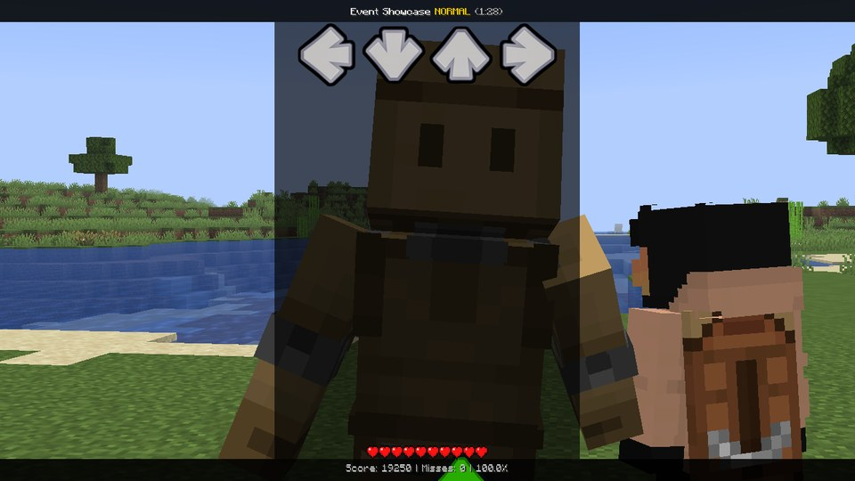

## Places: `bind`

A fight has two places: Boyfriend's (`"bf"`, in front, bottom right, with the camera behind it) and the opponent's
(`"dad"`, further away, on the left). Normally **you** always stand in front - even when you play the opponent side,
because the camera belongs behind you. But a song built like a classic stage might want Boyfriend's part in front, no
matter who plays it. One line in `onStart` does that:

```lua
function onStart()
    bind("boyfriend", "bf")      -- Boyfriend's part in front, whichever side the one watching plays
end
```

Now if you play the opponent side, you stand far left, and the other fighter is the one in front of the camera. The
camera itself doesn't move. `player.place` says where a fighter stands, [`atPlace("dad")`](../api/functions.md#atplace) gives the
fighter on a place, and `focus("dad")` turns the camera to it. `unbind("boyfriend")` puts everyone back.

`bind(who, x, y[, height])` pins a fighter to a spot on the screen instead - a shorter way to write the pinning
above.

## Cut to a box: `clip`

`clipLeft`, `clipTop`, `clipRight`, `clipBottom` (shares of the screen) cut a fighter off outside a box. Perfect for
a fighter inside a window frame, on a TV, or peeking through a rift in your stage art. Fights only.

```lua
-- Only inside the frame drawn at 0.3-0.7 x 0.2-0.8.
player.clipLeft = 0.3
player.clipRight = 0.7
player.clipTop = 0.2
player.clipBottom = 0.8
```

## Outlines

`outlineAlpha` draws a line around a fighter, in `outlineColor` and `outlineWidth` (pixels at 1080p, 0 = about 3).
With `outlineOnly = true` the fighter itself disappears and only the outline is left - a silhouette drawn with a pen,
like the creepy intro of a horror mod. Fights only.

```lua
-- Both of them as white outlines, fading in.
for i = 0, 1 do
    puppet[i].outlineOnly = true
    puppet[i].outlineAlpha = 0
    tween(puppet[i].outlineAlpha, 1, seconds(4))
end
```

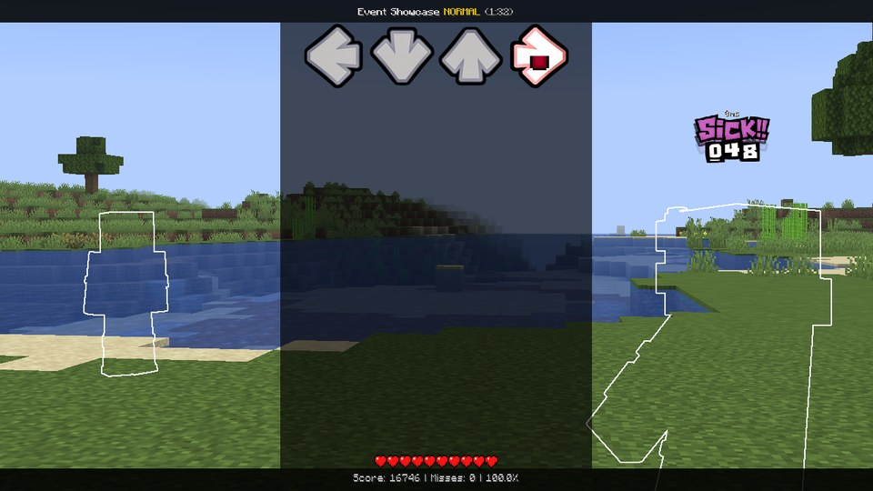

A fighter who glows in the world (a potion, another mod) doesn't glow on your own fight screen - it would get in the
way of the song's look. Everybody watching from outside still sees the glow, and it's back once the fight is over.

## Body parts

You can move every limb on its own. `player.head`, `.body`, `.leftArm`, `.rightArm`, `.leftLeg` and `.rightLeg`
each have `.pitch`, `.yaw`, `.roll` (degrees), `.x`, `.y`, `.z` (model pixels, 16 = a block), `.scale` and `.squash` -
what each one does is on [Body parts](../api/parts.md).

"Right", "left" and "forward" are always the figure's own. You see your own fighter from behind, so its right is your
right. The opponent faces you, so its right is on your left. Don't worry, it's simpler than it sounds: both arms at
`roll = 90` is a T-pose for either of them, and an arm straight up is `roll` around 165.

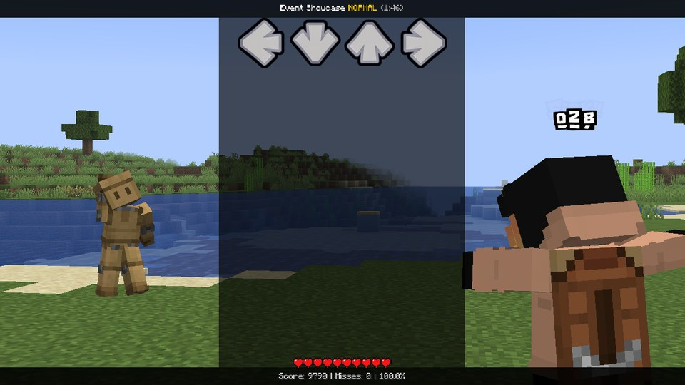

*`player.rightArm.roll = 90`, `player.leftArm.pitch = 90`, `player.head.pitch = 25`;
`opponent.rightArm.roll = 160`, `opponent.leftLeg.pitch = 45`, `opponent.head.roll = 25`.*

```lua
-- A wave: the right arm goes up and swings.
player.rightArm.roll = 150
for i = 0, 3 do
    after(beats(i * 0.5), function()
        tween(player.rightArm.roll, i % 2 == 0 ? 120 : 160, beats(0.5), "sineInOut")
    end)
end
after(beats(2), function() resetPuppet("player", beats(0.5)) end)
```

## On top of the animation, or instead of it

Normally everything you set goes **on top of** MineFunkin's own animation. The idle, the note poses with their pop
and rebound, the squash and stretch - all of that keeps running underneath, and your values are added to whatever
the animation is doing right then.

Set `animate = false` and the animation stops: the fighter stands still in its rest pose, and your values are the
whole pose. That's how you build your own moves:

```lua
local function armsUp(who)
    puppet[who].animate = false
    tween(puppet[who].leftArm.roll, 165, beats(0.25), "backOut")
    tween(puppet[who].rightArm.roll, 165, beats(0.25), "backOut")
    tween(puppet[who].head.pitch, -15, beats(0.25), "backOut")
end

function onEvent(p)
    armsUp(0)
    armsUp(1)
    after(beats(2), function() resetPuppet("both", beats(1)) end)
end
```

String eight moves like that together (clap, spread, reach, point, squat, kick, jump, spin), one per beat, have the
opponent dance them mirrored, and you've got a whole routine:

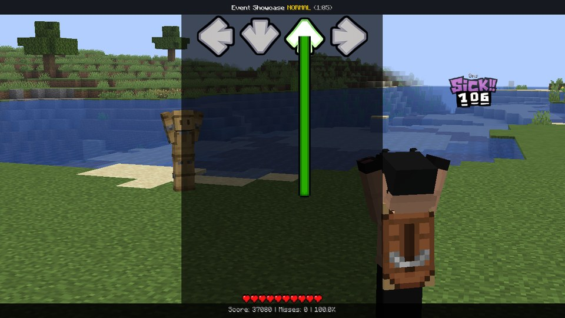

## `pose`: MineFunkin's own poses

Want a fighter to strike a pose without a note? `pose` plays MineFunkin's poses exactly the way a note would:

| Value | |
|---|---|
| `"left"`, `"down"`, `"up"`, `"right"` | Pops into that pose at the moment it's set and holds it, like a held note. |
| `"death"` | Plays the death: the fighter jolts back and sits down, and stays down. |
| `"none"` | Lets go: a held pose eases out like a released note, the death ends. The notes decide again. |

Switching straight from one direction to another pops the new one. And while a pose is set, the notes leave it
alone.

<div class="grid" markdown>

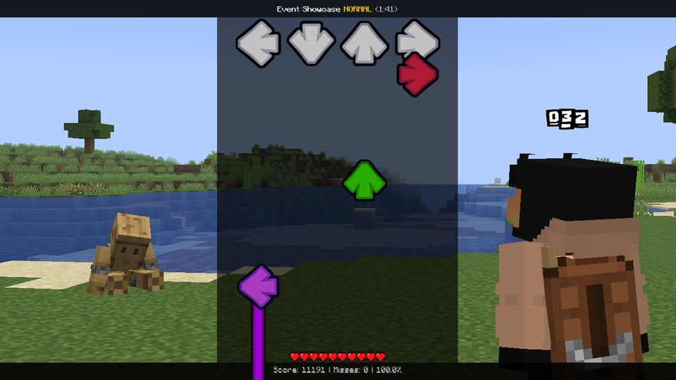

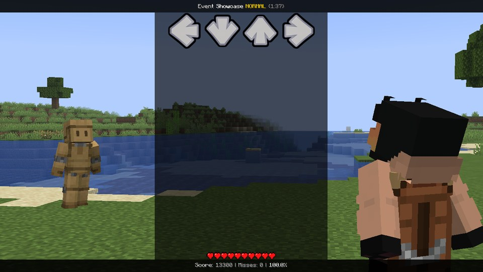

</div>

```lua
-- The opponent "sings" the chord with you, then drops.
opponent.pose = "left"
after(beats(1), function() opponent.pose = "right" end)
after(beats(2), function() opponent.pose = "death" end)
after(beats(6), function() opponent.pose = "none" end)
```

`animate = false` wins over `pose`: a fighter without animation stays in its rest pose.

## Your own poses: `setPose`

Don't like how the fighters pose? Give them your own. A song can replace MineFunkin's poses - the idle and each
direction - and the notes play yours with MineFunkin's pop, hold and ease. You build a pose part by part, in degrees,
just like `player.head.pitch`:

```lua
function onStart()
    -- "up": both arms high, head back.
    setPose("both", "up", "leftArm", 0, 0, 160)
    setPose("both", "up", "rightArm", 0, 0, 160)
    setPose("both", "up", "head", -20)
    -- "idle": hands on the hips.
    setPose("both", "idle", "leftArm", 0, 0, 35)
    setPose("both", "idle", "rightArm", 0, 0, 35)
end
```

The first call on a pose starts it from the rest pose, and every further call adds a part. `clearPose("both", "up")`
gives back MineFunkin's own (`clearPose("both")` = all five). In a fight, the players standing around see your song's
poses too. All the details: [setPose](../api/shortcuts.md#setpose).

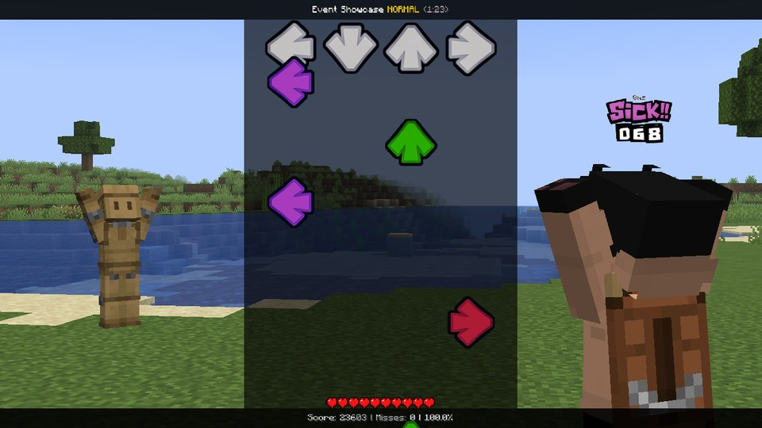

## Skins: `skin` and `model`

A fighter can wear a different Minecraft skin for part of the song - a costume change, a fake-out, or the two
swapping looks:

| Value of `player.skin` | |
|---|---|
| `""` | its own skin (the default) |
| `"player"`, `"opponent"` | that fighter's own skin - so the two can swap |
| `"skins/bf.png"` | a 64x64 Minecraft skin `.png` from the song folder (or its `events/` or `skins/` folder) |

```lua
-- Halfway through, the opponent turns into Boyfriend.
setSkin("opponent", "skins/bf.png")
setModel("opponent", "slim")

-- And the two swap looks:
setSkin("player", "opponent")
setSkin("opponent", "player")
```

`model` picks the arm shape: `"slim"` arms are 3 pixels wide (Alex), `"wide"` 4 (Steve). `"default"` goes with
whatever the skin itself says. A song can use up to 8 skin files, 1 MB each. Like everything on this page, only you
see the change - and in practice, the puppets wear it too.

## Squash and stretch with springy easings

```lua
player.squash = 0.4
tween(player.squash, 0, beats(1), "elasticOut")   -- lands like jelly
```

`elasticOut`, `backOut` and `bounceOut` overshoot and then settle - the same springy feel as the pop and rebound of
MineFunkin's own poses. They make almost anything look more alive.

## Recipes

**Squash on the kick:**

```lua
function onBeat(b)
    player.squash = 0.22
    tween(player.squash, 0, beats(0.9), "elasticOut")
    after(beats(0.5), function()
        opponent.squash = 0.22
        tween(opponent.squash, 0, beats(0.9), "elasticOut")
    end)
end
```

**Swap places.** The shortcut does it in one line, with the two jumping past each other:

```lua
swapFighters(beats(1))     -- again = back
```

Or by hand, if you want your own jump: in the default fight layout the opponent stands 7.4 blocks ahead and 3 to the
left of you. Move each fighter to the other's spot and turn it 180°, so they still face each other:

```lua
local function hop(who, x, z, turn)
    tween(puppet[who].x, x, beats(2), "sineInOut")
    tween(puppet[who].z, z, beats(2), "sineInOut")
    tween(puppet[who].turn, turn, beats(2), "sineInOut")
    tween(puppet[who].y, 2.5, beats(1), "quadOut")
    after(beats(1), function() tween(puppet[who].y, 0, beats(1), "quadIn") end)
end

function onEvent(p)
    hop(0, -3, 7.4, 180)
    hop(1, 3, -7.4, 180)
end
```

<div class="grid" markdown>

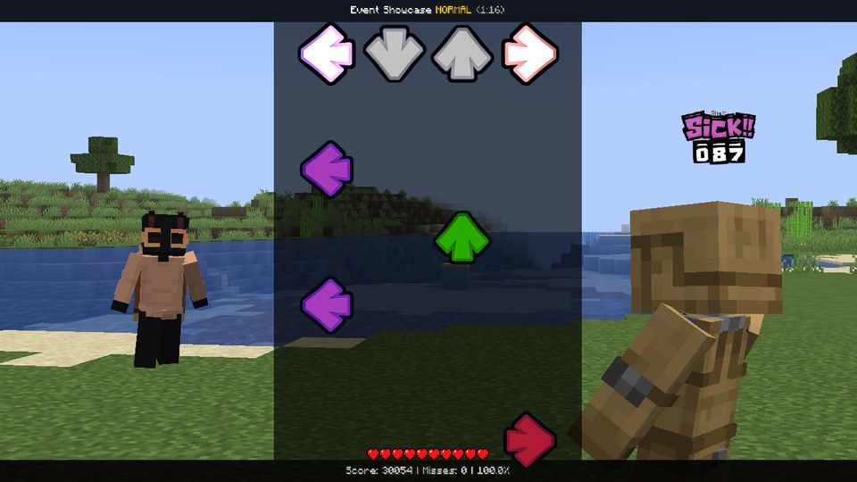

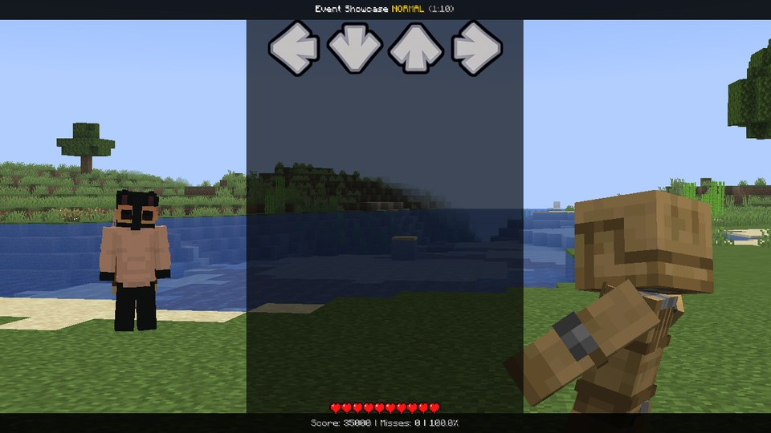

</div>

**Float.** Write `.y` and `.roll` every frame from `sin()`, and they bob around like they're underwater:

```lua
function onFrame(dt)
    local t = time / 1000
    player.y = 0.7 + 0.25 * sin(t * 1.7)
    player.roll = 7 * sin(t * 1.1)
    opponent.y = 0.9 + 0.3 * sin(t * 1.3 + 1)
end
```

**A giant.** Nothing says "boss fight" quite like it:

```lua
opponent.scale = 1
tween(opponent.scale, 2.2, beats(1.5), "elasticOut")
```

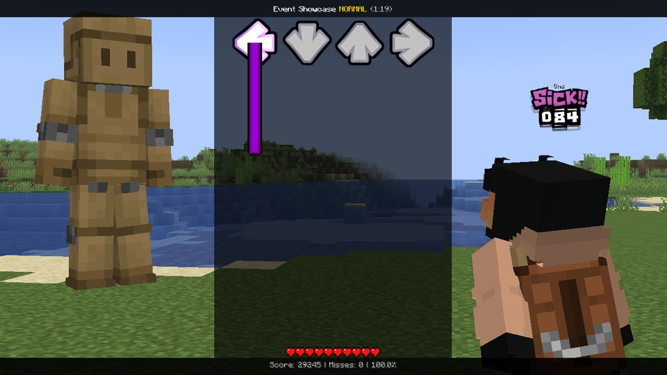

## Putting them back

```lua
resetPuppet("player")             -- at once
resetPuppet("opponent", beats(1)) -- over a beat
resetPuppet("both", beats(2))     -- or 0 / 1 for one of them
```

When the song ends, both go back on their own.

## Good to know

- Armor, capes and head items follow the pose and the tint. Elytra and shoulder parrots don't follow the body parts.
- A hidden fighter (`visible = false`, `alpha = 0` or `scale = 0`) isn't drawn at all - it costs nothing.
- Two things writing the same property every frame fight each other: the later one wins, and setting a property stops
  a tween on it. Give each effect its own properties.
