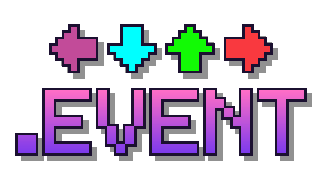

# Event scripts

{ .mf-page-logo }

A flash on the drop. Lanes spinning. Notes riding in on a wave. The camera swinging round, your opponent growing
three times taller, a whole stage appearing behind the fighters, the game window shaking when you miss. In
MineFunkin, every one of those is an **event script**: a small text file ending in `.event`, sitting right next to
the song.

Even the built-in events - Screen Shake, HUD Bounce, Scroll Speed and the rest - are just such files. So a song can
bring its own events, swap a built-in one for its own version, or listen to the whole song (every beat, every hit,
every miss) without a single chart event, the way a Psych Engine song script does.

Here's how small one can be:

```lua
format 1.1

event { name = "Big Drop" }

function onEvent(p)
    flash()                -- a white flash
    zoom(1.15)             -- zoom in and stay there
    flipScroll()           -- downscroll becomes upscroll
end
```

Save it as `big_drop.event` in a song's folder, place **Big Drop** in the chart editor, done. Those three calls are
[shortcuts](../api/shortcuts.md) - one line for the stuff charts do all the time. Once you want more than that, you
build it from [properties](../api/properties.md), [tween](../api/actions.md#tween) and
[callbacks](../api/callbacks.md), and the pages below show you how.

## Learn it in this order

You don't have to read everything. Go through the first four, then jump to whatever you want to build.

1. **[Your first event](tutorial.md)** - from an empty file to a working event, step by step.
2. **[Templates](templates.md)** - working files to copy and fill in.
3. **[In the chart editor](editor.md)** - placing events and setting their values.
4. **[Song scripts](song-scripts.md)** - react to every beat, hit and miss of a song.
5. Then pick what you need: [modcharts](modcharts.md), [stages and sprites](stages.md), [the fight camera](camera.md),
   [the fighters](fighters.md), [effects](effects.md), [shaders](shaders.md), [sounds](sound.md),
   [the game window](windows.md).

Coming from Psych or Kade? The [Psych Engine](psych.md) and [Kade Engine](kade.md) pages go through their APIs name
by name and tell you what it's called here. Rather copy something that already works? Have a look at the
[cookbook](cookbook.md), or take apart [the Event Showcase](showcase.md) - a whole song built to show off every
feature. Stuck? Check the [FAQ](../help/faq.md) and [errors and fixes](../help/troubleshooting.md); most problems are
in there.

And whenever you need to look up a name, the **[Event API](../api/index.md)** has every single one, each with an
example.

## Three ways a script can run

| | How it works | For example |
|---|---|---|
| **As a chart event** | You place it in the chart editor; `onEvent` runs when the song gets there. | a flash on the drop |
| **As a song script** | No chart event at all: its `onBeat`, `onHit`, `onFrame`, ... run for the whole song. | a modchart, a stage, a combo counter |
| **As a replacement** | Give your file the name of a built-in event, and the song uses yours instead. | your own Screen Shake |

In practice most events are a bit of both: `onEvent` flips a mode on or off, and `onBeat` or `onFrame` do the actual
work while it's on. [Song scripts](song-scripts.md) goes into that.

## Where your files go

Put them in the song's folder, or in an `events/` folder inside it. That's it - MineFunkin doesn't look anywhere else.
The chart editor shows you the built-in events plus the files of the song you're editing, and never the files of
other songs. If you change a file while the editor is open, press **Reload** at the bottom of the inspector.

When a server has a song, its event files travel along with it, so everybody plays the same thing.

If two of your files use the same name, the one that comes first alphabetically wins, and the editor tells you about
the other one.

## Practice, fights, replays

Your events run everywhere the song does: practice at the Retro TV, fights at a Speaker (against the dummy or a real
player), when someone watches a fight from inside, and in replays.

A few things only make sense with a real world around you - the fight camera, a stage painted onto the world,
outlines around the fighters, effects on the world only, and health. They're marked
<span class="mf-tag fight">fights</span> wherever they show up. The fighters themselves work in practice too: there
they're the two puppets next to the lanes.

If an event only belongs in one place, say so in its header with `only = "fight"`, or check
[`song.mode`](../api/song.md#song-mode) in the code. [Song scripts](song-scripts.md#practice-or-fight-only-and-songmode)
shows both.

## Is this safe?

Yes - and on purpose. When you download a song from somebody, its scripts can only use what's in this wiki. They
can't read or write your files (pictures, sounds and shaders come from the song's own folder only), they can't go on
the internet, and they're stopped if they try to do too much work at once ([limits](../help/limits.md)).

A file with a mistake in it never runs at all. Instead the chart editor shows you the line, the column and, most of
the time, a "did you mean ...?" - and the same goes into the [event log](../help/troubleshooting.md#the-event-log).
