# Modcharts

Lanes that sway like they've had one too many. Arrows spinning on their way in. Notes riding in on a wave, or
sneaking in from the side. That's a **modchart** - and it's probably the most fun you can have with event scripts.

In MineFunkin a modchart is nothing special: just event files. Usually one [song script](song-scripts.md) runs the
whole thing, or you place events in the chart to switch effects on and off. Everything on this page works everywhere -
in practice at the Retro TV and in fights.

There are two ways to write one, and you can mix them. This page moves the lanes with **properties**
(`strum[0].x = ...`, worked out in `onFrame`) - the Psych and Kade way. The other is **[modifiers](modifiers.md)**, where
you plan `sway`, `downscroll`, `turnZ` and seventy others on the song's beats, in 3D, on as many playfields as you
like. For a long, planned modchart that's the better fit.

Grab what you like, change the numbers, see what happens. That's honestly how most good modcharts get made. Every
property used here is explained in full on [strum[lane]](../api/strum.md), [strums](../api/strums.md) and
[note[i]](../api/notes.md).

## Start with this

Here's an empty modchart, ready to fill in. Save it as `modchart.event` in the song's folder:

```lua
format 1.1
-- The song's modchart: everything that moves the lanes, in one place.

event {
    name = "Modchart",
    category = "Song script",
    description = "Runs for the whole song - no chart event needed.",
}

function onStart()
    -- set things up before the countdown
end

function onFrame(dt)
    -- things that move all the time; work them out from time or beat
end

function onBeat(b)
    -- things that happen on a beat
end

function onStep(n)
    -- things that happen on an exact step (four per beat)
end
```

<p class="mf-like">Kade: <code>modchart.lua</code> with <code>start</code>, <code>update</code>, <code>beatHit</code>, <code>stepHit</code> · Psych: a script in <code>data/song-name/</code></p>

## The three tools

Everything you can move falls into one of three groups:

| Tool | Moves | Properties |
|---|---|---|
| **Lanes** | a receptor and everything in its lane | `strum[lane].x`, `.y`, `.angle`, `.scale`, `.alpha`, ... and the whole strumline `strums.*` |
| **The way in** | where a lane's notes come from and how fast | `strum[lane].direction`, `.speed`, `.noteAngle` |
| **Notes one by one** | each note on its own | `note[i].x`, `.y`, `.alpha`, `.angle`, `.scale`, `.visible` |

## At a specific part of the song

An effect that runs through the whole song gets old quickly. Here are three ways to switch one on and off:

```lua
-- 1. By step, in the script itself (step 64 = bar 5).
function onFrame(dt)
    if step >= 64 and step < 128 then
        for lane = 0, 3 do
            strum[lane].angle = time / 3        -- spinning from bar 5 to bar 9
        end
    end
end

function onStep(n)
    if n == 128 then
        for lane = 0, 3 do tween(strum[lane].angle, 0, beats(1)) end
    end
end
```

```lua
-- 2. By a chart event: place it where it starts, and again where it stops.
params {
    on = bool { from = "value1", default = true, label = "On" },
}

local active = false

function onEvent(p)
    active = p.on
    if not active then resetLanes(beats(1)) end
end

function onFrame(dt)
    if not active then return end
    -- the effect
end
```

```lua
-- 3. By section (every 4 beats).
function onSection(n)
    if n == 16 then flipScroll() end
    if n == 24 then flipScroll() end
end
```

The first keeps the whole modchart in one file, which is nice for reading it later. The second lets you drag it
around in the chart editor until it sits right. Pick whatever feels better - you can mix them, too.

---

## Lanes

### Sway: from side to side

```lua
function onFrame(dt)
    for lane = 0, 3 do
        strum[lane].wobbleX = 14 * sin(time / 1000 * 3.2 + lane * 0.9)
    end
end
```

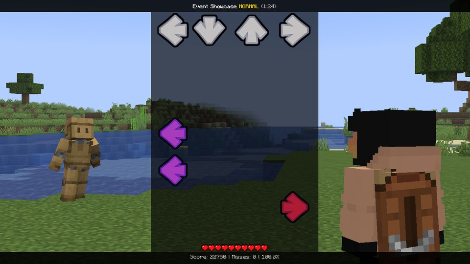

### Flip sides: left becomes right

```lua
function onEvent(p)
    for lane = 0, 3 do
        tween(strum[lane].x, (3 - 2 * lane) * strums.spacing, beats(0.75), "backOut")
    end
end
```

Lane 0 moves three lanes to the right, lane 3 three to the left, and the middle two swap. Your keys stay the same -
so the left arrow is suddenly on the right. Mean, but fun. Tween them back to 0 to undo it.

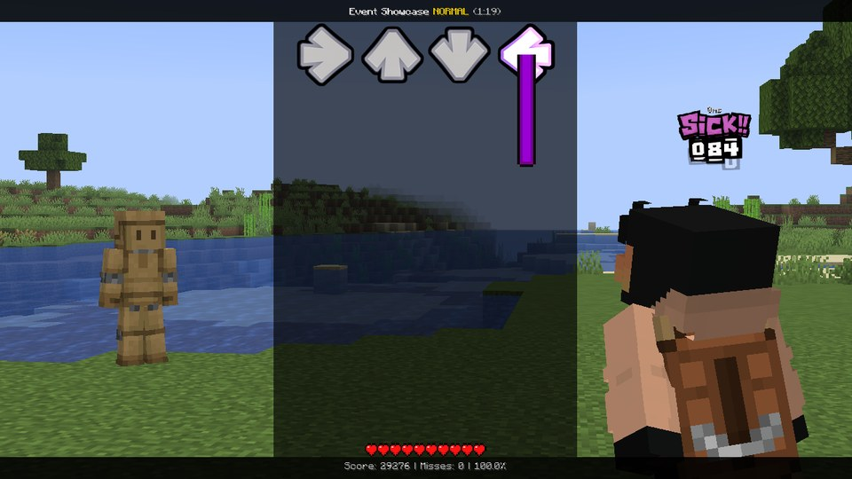

### Split scroll: two up, two down

```lua
function onEvent(p)
    flipScroll(2)
    flipScroll(3)
    after(beats(8), function() resetLanes() end)
end
```

### Vanishing beats: the notes go, the receptors stay

```lua
function onBeat(b)
    if b % 4 != 2 then return end
    for lane = 0, 3 do
        strum[lane].noteAlpha = 0
        tween(strum[lane].noteAlpha, 1, beats(1), "quadIn")
    end
end
```

`noteAlpha` fades only the notes and holds - the receptors stay, so the player still knows where to hit. Just not
what's coming.

### Lanes in the singer's colour

```lua
function onOpponentHit(note)
    strum[note.lane].color = #FF6060
    tween(strum[note.lane].color, #FFFFFF, beats(0.5))
end
```

### Spin, one lane after the other

```lua
function onEvent(p)
    for lane = 0, 3 do
        after(beats(0.25 * lane), function()
            strum[lane].angle = 0
            tween(strum[lane].angle, 360, beats(1), "backOut")
        end)
    end
end
```

Ever wondered why each lane gets its own number inside `after`, even though the loop has moved on? Every
`function() ... end` remembers the locals as they were the moment it was made.

### Pop on the beat

```lua
function onBeat(b)
    for lane = 0, 3 do
        after(steps(lane * 0.5), function()
            strum[lane].scale = 1.25
            tween(strum[lane].scale, 1, beats(0.75), "elasticOut")
        end)
    end
end
```

### Circles

```lua
function onFrame(dt)
    local t = time / beats(4) * 2 * pi   -- one circle per bar
    for lane = 0, 3 do
        local a = t + lane * pi / 2
        strum[lane].x = 24 * cos(a)
        strum[lane].y = 24 * sin(a)
    end
end
```

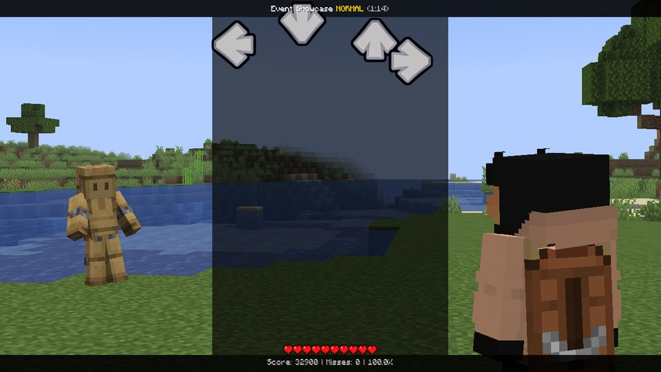

### Spread apart on every eighth (Accordion)

```lua
function onStep(n)
    if n % 2 != 0 then return end
    for lane = 0, 3 do
        strum[lane].x = (lane - 1.5) * strums.spacing * 0.6
        tween(strum[lane].x, 0, steps(1.8), "quadOut")
    end
end
```

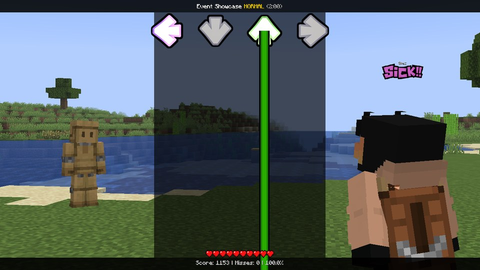

### Ghost lanes: the next lane fades every beat

```lua
function onBeat(b)
    local lane = b % 4
    strum[lane].alpha = 0.2
    tween(strum[lane].alpha, 1, beats(1.5), "quadIn")
end
```

### The whole strumline jumps (Zigzag)

```lua
local side = 1

function onBeat(b)
    side = -side
    tween(strums.x, side * 40, beats(0.5), "backOut")
end
```

---

## The way in

### Side doors

```lua
function onEvent(p)
    strum[0].direction = -90     -- lane 0's notes come in from the right ...
    strum[3].direction = 90      -- ... lane 3's from the left
    after(beats(8), function() resetLanes(beats(1)) end)
end
```

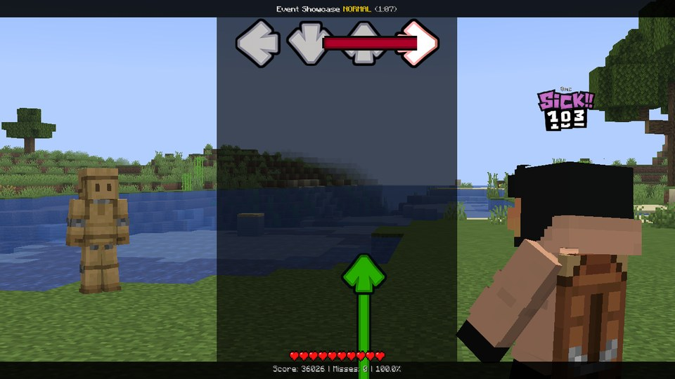

`direction` turns the lane's way in clockwise around its receptor. The notes themselves stay upright, so the arrows
still point the way you press - only where they come from changes.

### Tilted and slow

```lua
function onEvent(p)
    for lane = 0, 3 do
        strum[lane].direction = 30     -- every lane comes in at a slant
        strum[lane].speed = 0.6        -- and slower
    end
end

function onFrame(dt)
    strum[1].noteAngle = time / 3      -- lane 1's notes spin on their way in
end
```

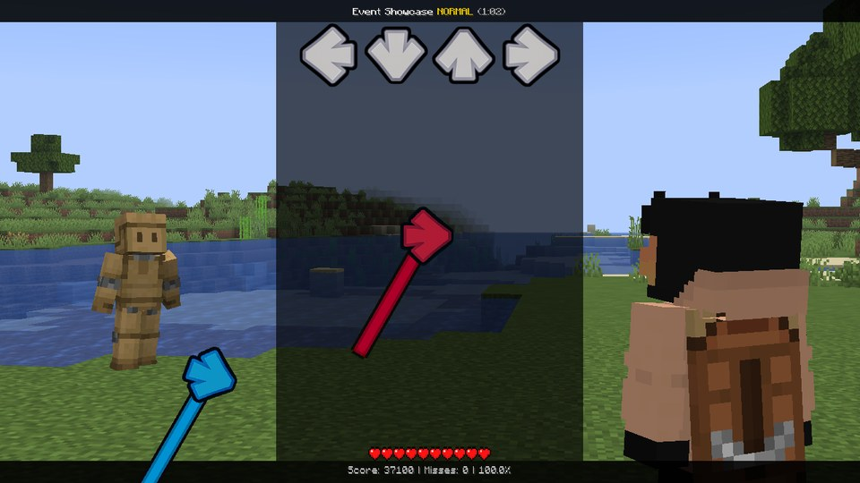

### One lane faster

```lua
function onEvent(p)
    strum[2].speed = 2        -- the up lane's notes come twice as fast
end
```

A faster lane shows its notes later and they fly in quicker - the classic "trap lane". `resetLanes()` puts the speed
back along with everything else.

---

## Notes one by one

This is where it gets really wild. `note[0]` ... `note[notes.count - 1]` are your notes on their way in, the next
one first, and you can move every single one of them.

Set them in `onFrame`, every frame - they go back to normal before each frame, so you can't break anything for good.
Most effects are built from `note[i].distance`: how many ms until the note has to be hit. Far away, close by, and
everything in between.

### Sway notes: a wave they ride in on

```lua
function onFrame(dt)
    for i = 0, notes.count - 1 do
        local d = note[i].distance
        note[i].x = sin(d / 120 + time / 400) * 30
        note[i].alpha = clamp(1.6 - d / 700, 0, 1)    -- far away = see-through
    end
end
```

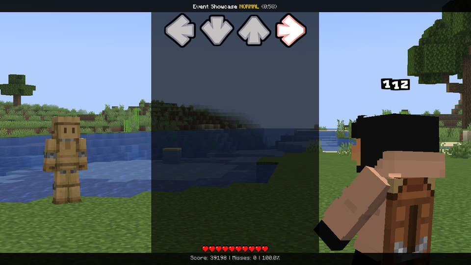

!!! tip "Landing exactly on the receptor"
    At `distance` 0 the wave above is still somewhere between -30 and 30 pixels. To make every note land
    right on its receptor, let the offset shrink near it: multiply by `clamp(d / 300, 0, 1)`.

### Hide near and hide far

```lua
function onFrame(dt)
    for i = 0, notes.count - 1 do
        local d = note[i].distance
        -- Hide near: notes vanish as they get close (between 450 and 250 ms before the hit).
        note[i].alpha = smoothstep(250, 450, d)
    end
end
```

Swap the two numbers (`smoothstep(450, 250, d)` → 1 near, 0 far) and it's **hide far**: the notes only show up at the
very last moment. Both are properly hard, so keep them short.

### Grow as they come

```lua
function onFrame(dt)
    for i = 0, notes.count - 1 do
        note[i].scale = 0.5 + 0.5 * (1 - clamp(note[i].distance / 1000, 0, 1))
    end
end
```

### Every other note from the other side

```lua
function onFrame(dt)
    for i = 0, notes.count - 1 do
        local d = note[i].distance
        local side = note[i].time / beats(1) % 2 < 1 ? 1 : -1      -- by beat: left, right, left, ...
        note[i].x = side * clamp(d / 4, 0, 160)                     -- 0 on the receptor
    end
end
```

### Spinning, but only in one lane

```lua
function onFrame(dt)
    for i = 0, notes.count - 1 do
        if note[i].lane == 1 then note[i].angle = note[i].distance / 3 end
    end
end
```

(For a whole lane at once, `strum[1].noteAngle` is shorter.)

### Held notes glow

```lua
function onFrame(dt)
    for i = 0, notes.count - 1 do
        if note[i].held then note[i].scale = 1.15 end
    end
end
```

---

## Modchart classics

The big moves from Taro / Kade style Lua modcharts, the way [the Event Showcase](showcase.md) does them. The
showcase's files ease them in and out nicely; here you get just the core of each, so it's easy to see how it works.

### Kicked on the drums

```lua
local flip = 1

-- Sideways on 0, 0.75, 1.5 and 2.25 of every bar, each time the other way.
function onStep(n)
    local s = n % 16

    if s == 0 or s == 3 or s == 6 or s == 9 then
        flip = -flip
        for lane = 0, 3 do
            strum[lane].wobbleX = 24 * flip
            tween(strum[lane].wobbleX, 0, beats(0.75), "cubicOut")
        end
    end
end
```

### Off the screen and back

```lua
function onFrame(dt)
    local b = time / beats(1)
    local far = screen.height * 1.2

    for lane = 0, 3 do
        local side = lane % 2 == 0 ? 1 : -1
        strum[lane].y = clamp(30 * side * tan(b * 0.25 * pi), -far, far)
    end
end
```

`tan()` runs off to infinity at beat 2 of every bar: half the lanes shoot off the top, half off the bottom, and then
they come back in from the other side. Looks amazing, plays terribly - so keep it to bars where the player has no
notes.

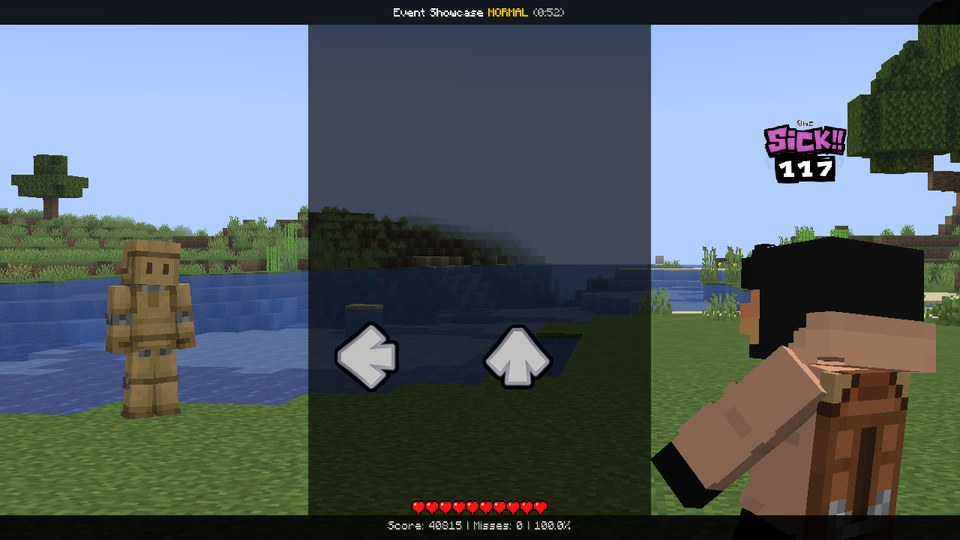

### Across the screen, wrapping round

```lua
function onFrame(dt)
    local w = screen.width
    local s = strums.spacing
    local pos = time / beats(8) * w    -- a screen width every two bars

    for lane = 0, 3 do
        local home = w / 2 + (lane - 1.5) * s
        local x = (w / 8 + lane * w / 4 + pos) % w
        strum[lane].x = x - home
    end
end
```

`home` is where the lane normally sits (the strumline is centred), and `x` is where it should be now: a quarter of
the screen apart, sliding right. The `%` wraps it back round when it reaches the edge.

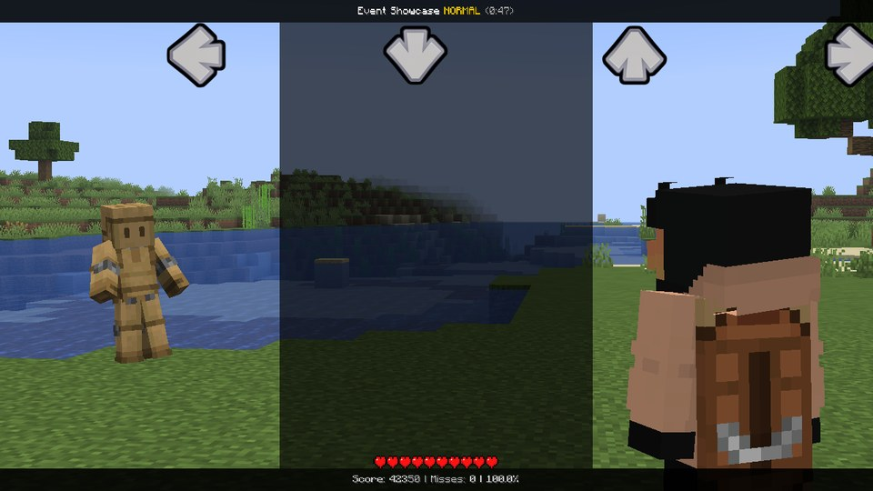

### Upside down, the world upright

```lua
function onEvent(p)
    hud.extras = false
    tween(hud.angle, 180, beats(4), "cubicInOut")
    tween(camera.roll, -180, beats(4), "cubicInOut")

    for lane = 0, 3 do
        tween(strum[lane].x, (3 - 2 * lane) * strums.spacing, beats(4), "cubicInOut")
        tween(strum[lane].angle, -180, beats(4), "cubicInOut")
    end
end
```

Just turning the HUD over would put the lanes in reverse order with every arrow upside down. Mirroring them and
turning the arrows back makes it play like plain old downscroll - it only *looks* crazy. In a fight the camera rolls
along with `hud.angle`, and `camera.roll` turns it back, so the world stays the right way up.

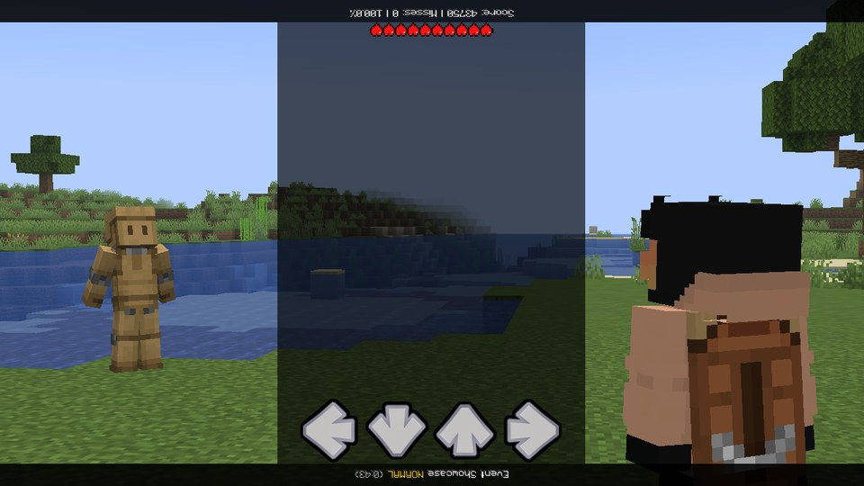

### A ring (Halo)

```lua
function onFrame(dt)
    local s = strums.spacing
    local turn = time / beats(4) * 2 * pi    -- one turn a bar

    for lane = 0, 3 do
        local a = turn + lane * pi / 2
        local depth = cos(a)                 -- 1 = at the front, -1 = at the back
        strum[lane].x = 2.4 * s * sin(a) - (lane - 1.5) * s
        strum[lane].y = 0.55 * s * depth
        strum[lane].scale = 1 - 0.2 * (1 - depth)
        strum[lane].alpha = 1 - 0.25 * (1 - depth)
    end
end
```

`- (lane - 1.5) * s` cancels the lane's own place, so all four ride the same ring around the middle. The ones at the
back are smaller and fainter, which sells the 3D.

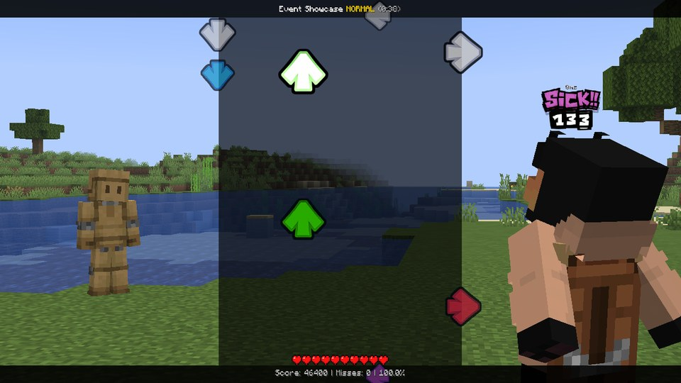

Kade Engine's own example modcharts (spinning receptors, the spinning HUD, jumping arrows, ...) are translated one
by one on [Coming from Kade Engine](kade.md#kades-examples-translated).

---

## Effects that fight each other

Here's the one thing that trips everybody up: a property can only be driven by one thing at a time. Setting it stops
a tween on it, and two scripts writing it every frame just overwrite each other (the
[event log](../help/troubleshooting.md#the-event-log) tells you which two).

The fix is easy. Give every effect that runs at the same time its own **channel**: one uses `x`, the next `wobbleX`, a
third `angle`. The ways in and `note[i]` are channels of their own and stack with everything. More on that on
[strum[lane]](../api/strum.md).

## Keep it playable

Everything on this page makes the song harder, and some of it a *lot* harder. A modchart should be a fun surprise,
not a wall. A few rules of thumb:

- Big changes (mirroring, splitting the scroll, a new way in) work best right before a little break, so the player
  can see the new layout before the notes arrive.
- A wobble of a few pixels makes the lanes feel alive and costs nothing. A wobble of a whole lane width is a different
  song.
- Don't fade a lane out completely while notes are coming in it. Hide near / hide far: short bursts only.
- Save the wildest stuff (lanes off the screen, the playfield turning over) for bars where only the opponent sings.
- Scattering the lanes to random places (`scatterStrums()`, the built-in Note Scramble) is the hardest of all, because
  nobody can learn it. Use it rarely - or better, not at all.
