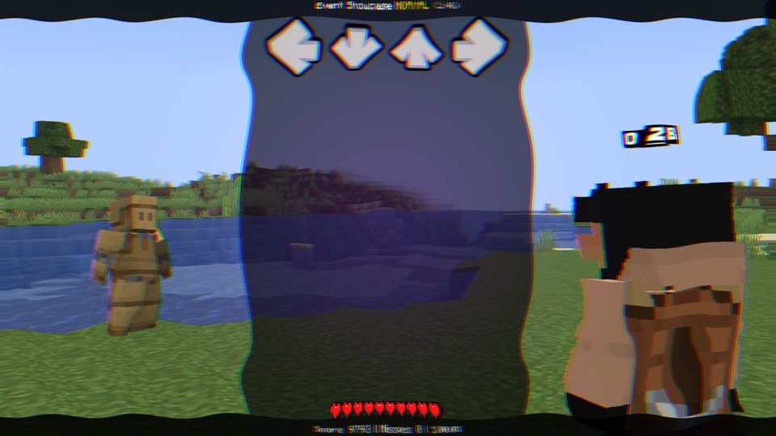
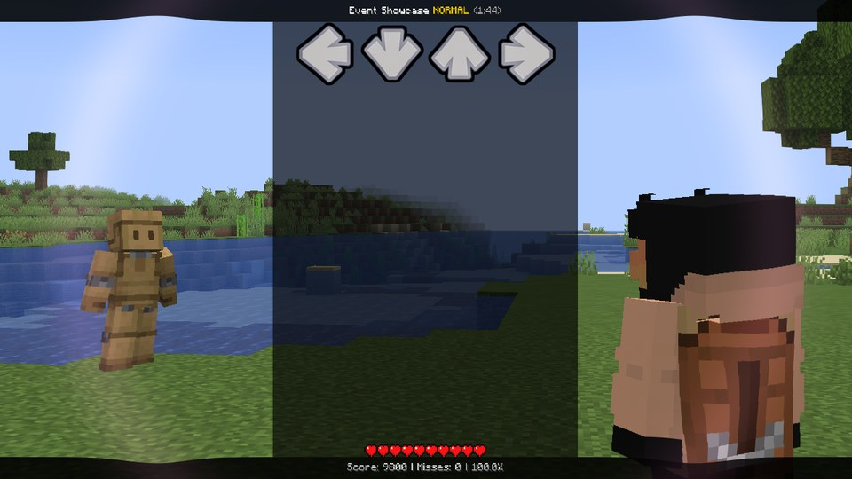
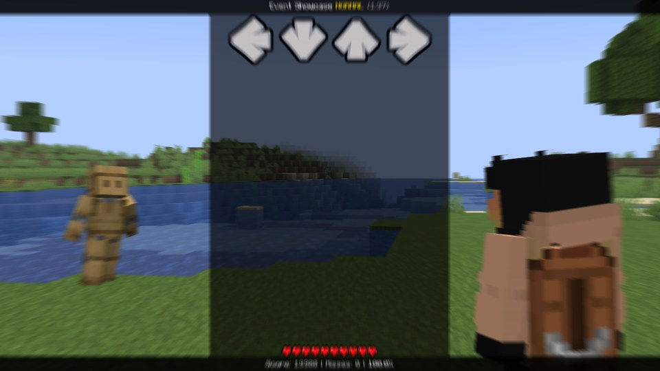
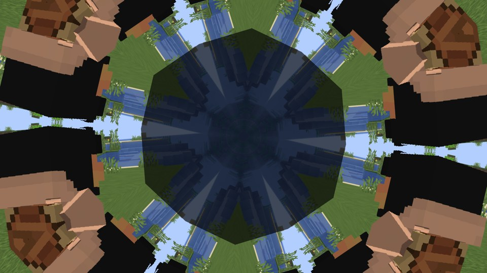
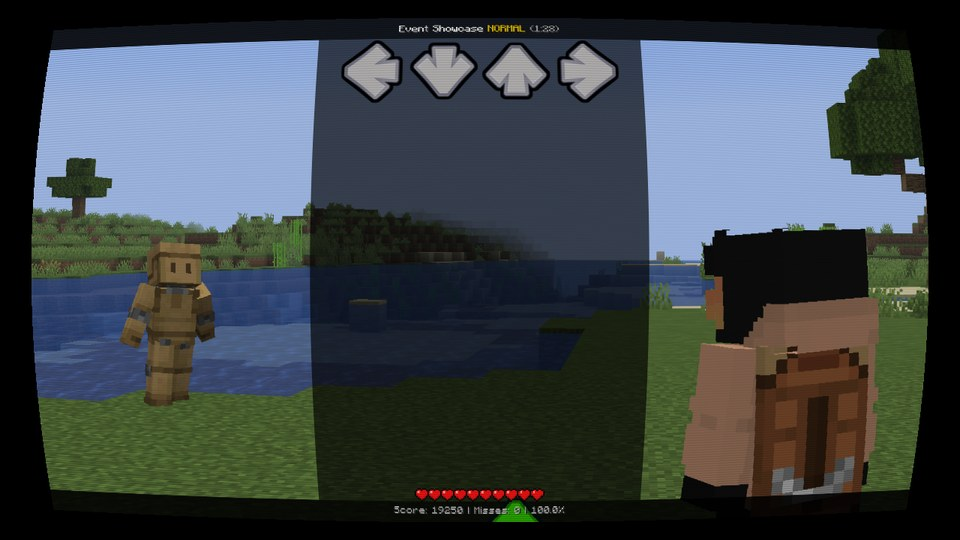

# Your own shaders

The built-in [effects](effects.md) cover a lot. But when you want something nobody has thought of yet - a ripple
from the middle of the screen, a kaleidoscope, a shockwave on the drop - you write your own shader.

A song can bring its own GLSL fragment shaders: `.fsh` files (MineFunkin's own kind) or `.frag` files written for Psych
Engine, in the song's folder, its `events/` folder or its `shaders/` folder. A script switches them on through four
slots, `shader[0]` to `shader[3]`. Up to four run at once, in slot order, right before the built-in effects.

A slot has a `file`, an `amount` (how much of it shows), four numbers `a` ... `d` you can hand to the shader, a
`target`, and a read-only `status` - all on the [shader[n]](../api/shader.md) page.

Never written a shader? No shame - they look scarier than they are. The examples below work as they are, so start by
changing their numbers and see what happens.



## The file

The file holds one function, `effect`. It runs for every single pixel on the screen: it gets that pixel's position
(0 to 1, from the bottom left) and returns the colour that should be there.

```glsl
// ripple.fsh - rings from the middle, a purple glow on the beat.
vec4 effect(vec2 uv) {
    vec2 d = uv - 0.5;
    d.x *= resolution.x / resolution.y;
    float r = length(d);
    float pulse = 1.0 - fract(beat);
    float wave = sin(r * 40.0 - time * 8.0) * 0.01 * (0.4 + pulse) * params.x;
    vec3 c = pixel(uv + normalize(d + 1e-5) * wave).rgb;
    c += vec3(0.2, 0.05, 0.3) * pulse * smoothstep(0.6, 0.0, r) * params.y;
    return vec4(c, 1.0);
}
```

And here's the script that switches it on, fading it in over two beats:

```lua
function onEvent(p)
    shader[0].file = "ripple.fsh"
    shader[0].a = 1
    shader[0].b = 1
    shader[0].amount = 0
    tween(shader[0].amount, 1, beats(2))
end
```

## What the file can use

| | |
|---|---|
| `pixel(uv)` | the picture at that spot (a `vec4`) |
| `resolution` | the picture's size in pixels |
| `time` | the song time in **seconds** (in scripts it's milliseconds) |
| `beat` | the song position in beats, with fractions: `fract(beat)` goes 0 → 1 every beat |
| `amount` | the slot's amount |
| `params` | the slot's a, b, c, d as `params.x`, `.y`, `.z`, `.w` |

Those names are taken, so don't declare your own `time`, `beat`, `params` and so on. Everything else is plain GLSL
3.30: your own functions, constants, loops, `#define`s. You don't need a `#version` line (it's ignored anyway).

The result is mixed with the picture by `amount` and is always opaque - so `amount` is the easy way to fade a shader in
and out.

## Handing the shader a moment

A shader has no memory: every frame it starts from scratch. So how do you make something happen *from a certain
moment on*, like a shockwave on the drop? Hand it the song time of that moment, and let it count from there:

```lua
function onEvent(p)
    shader[1].file = "shockwave.fsh"
    shader[1].a = 1        -- strength
    shader[1].b = 1.1      -- speed
    shader[1].c = time / 1000   -- now, in seconds
end
```

```glsl
// shockwave.fsh - a ring that runs out from the middle, bending the picture as it passes.
vec4 effect(vec2 uv) {
    float age = time - params.z;
    if (age < 0.0 || age > 1.6) {
        return pixel(uv);
    }

    vec2 aspect = vec2(resolution.x / resolution.y, 1.0);
    vec2 d = (uv - 0.5) * aspect;
    float r = length(d);
    float ring = r - age * params.y;
    float bend = exp(-(ring * ring) / 0.0049) * params.x * (1.0 - age / 1.6);
    vec2 dir = d / max(r, 0.0001);
    vec4 c = pixel(uv - dir / aspect * bend * 0.035);
    c.rgb += bend * 0.18 * vec3(1.0, 0.55, 0.85);
    return c;
}
```

## More examples

<div class="grid" markdown>









</div>

*The examples on this page, as they look in a fight: the shockwave's ring, the warp's zoom blur, the kaleidoscope on
`"screen"` (it folds the notes and the HUD too - on `"world"` they'd stay put), and the CRT's curved old screen.*

??? example "warp.fsh - a zoom blur that kicks on every beat"

    ```glsl
    vec4 effect(vec2 uv) {
        float kick = pow(1.0 - fract(beat), 3.0);
        float amount = (0.015 + 0.07 * kick) * params.x;
        vec2 dir = uv - 0.5;
        vec3 sum = vec3(0.0);

        for (int i = 0; i < 12; i++) {
            float t = float(i) / 11.0;
            sum += pixel(uv - dir * amount * t).rgb;
        }

        return vec4(sum / 12.0, 1.0);
    }
    ```

??? example "kaleido.fsh - the picture folded into turning mirrored slices"

    ```glsl
    // params.x = slices, params.y = turning speed (radians per second)
    vec4 effect(vec2 uv) {
        float aspect = resolution.x / resolution.y;
        vec2 p = (uv - 0.5) * vec2(aspect, 1.0);
        float r = length(p);
        float slices = max(2.0, params.x);
        float slice = 6.2831853 / slices;
        float a = mod(atan(p.y, p.x) + time * params.y, slice);
        a = abs(a - slice * 0.5);
        float sweep = -2.3 + time * params.y * 0.6;
        vec2 q = vec2(cos(a + sweep), sin(a + sweep)) * r * 0.85;
        return pixel(clamp(q / vec2(aspect, 1.0) + 0.5, 0.001, 0.999));
    }
    ```

??? example "crt.fsh - a curved old screen"

    ```glsl
    vec4 effect(vec2 uv) {
        vec2 c = uv * 2.0 - 1.0;
        c *= 1.0 + 0.08 * params.x * dot(c, c);
        vec2 st = c * 0.5 + 0.5;
        if (st.x < 0.0 || st.x > 1.0 || st.y < 0.0 || st.y > 1.0) {
            return vec4(0.0, 0.0, 0.0, 1.0);
        }
        vec3 col = pixel(st).rgb;
        col *= 0.85 + 0.15 * sin(st.y * resolution.y * 3.14159);
        return vec4(col, 1.0);
    }
    ```

## Shaders from Psych Engine (`.frag`)

Got a shader from a Psych mod? A `.frag` file written for Psych (Flixel) runs as it is - put it where `.fsh` files
go and name it in `shader[n].file`. MineFunkin gives it everything Flixel would: `#pragma header`, `bitmap`,
`openfl_TextureCoordv`, `openfl_TextureSize`, `flixel_texture2D`, `texture2D` and `gl_FragColor` all work.

Its own `uniform float` / `int` / `bool` values (the first eight) are set from a script with
[`setShaderFloat`](../api/shortcuts.md#setshaderfloat) - Psych's call, with the slot instead of the tag:

```lua
function onStart()
    shader[0].file = "chroma.frag"
    setShaderFloat(0, "intensity", 0.5)
end

function onBeat(b)
    setShaderFloat(0, "intensity", 1.5)
end
```

A value you don't set is 0 - except `iTime`, which runs along with the song's seconds. `uniform vec2 iResolution`
(or `vec3`) is the picture's size. Your own `.fsh` files can declare `uniform float` values the same way.

## Which shaders run: the check

A little honesty here: a shader runs on the player's graphics card, and once it has started drawing, nothing can
stop it. A loop that never ends freezes the whole game. That's why the player decides which song shaders run
(Options › MineFunkin › Song effects):

| Setting | |
|---|---|
| Off | No song shader runs. |
| All checked | Every song's shaders must pass MineFunkin's check. |
| Own songs unchecked (default) | The player's own songs run freely; songs from a server must pass the check. |
| All unchecked | Everything runs. |

**The check** makes sure a shader always finishes. A checked file may only loop with `for` over number bounds - a literal, a `#define N 12` or a
`const int N = 12;` - with the counter declared in the loop's head and not changed inside it. At most 8192 loop rounds
and 256 picture reads per pixel (nested loops and function calls multiplied). No `out` / `inout` parameters, no
preprocessor lines except `#define NAME number` and `#pragma header` / `#pragma body`. A file that doesn't pass isn't
run: [`shader[n].status`](../api/shader.md#shader-status) says `"refused"`, and the event log says why. If your song
will be played on servers, write with the check in mind - every example on this page passes it.

**The cost.** MineFunkin measures how long every song shader takes on the graphics card. One that takes more than
25 ms per frame (on average over 30 frames) is switched off for the rest of the song, so nobody's stuck at 20 fps:
`status` = `"too heavy"`.

## When it doesn't compile

A shader with a mistake in it is switched off, and the graphics driver's message goes to the
[event log](../help/troubleshooting.md), with line numbers counted from the first line of your file:

```
[ERROR] Shader "broken.fsh" doesn't compile (lines count from the file's first line):
0:2(21): error: `undefinedThing' undeclared
```

`0:2` means line 2 of your file. A file is read once per song, so after you've fixed it, restart the song.

## Limits and good to know

- `.fsh` or `.frag`, at most 32 KB a file, at most four at once. Only the song's own folder (and its
  `events/` and `shaders/` folders): a path that leads out of it is refused.
- A file that isn't checked (your own songs, by default) can still freeze the game with a loop that never ends - so
  keep them simple, and test on a weaker machine if you can. Your players will thank you.
- `"world"` and `"terrain"` shaders need a fight. In practice only `"screen"` ones run.
- They get along with shader packs (Iris): the pack draws the world, your shader goes on top.
