# The Event Showcase

Want to see what all of this looks like in one go? The Event Showcase is a complete song - two minutes, 140 BPM,
intro to outro - where every single effect is an event file in the song's folder. 31 of them, plus 2 shaders.

Every big feature gets its own moment: texts and pictures, the callbacks, the HUD and the strum background, a whole
modchart (lanes that jiggle, fly off the screen, scroll across it, turn upside down and ride a ring), the fight
camera, the fighters (a dance, a death, a giant, swapping places), built-in effects and the song's own shaders. While
it plays, a caption in the top left names each feature right as it starts.

And it's meant to be taken apart: the event files are commented, so open them up, read them, and copy whatever you
like into your own songs.

[:material-download: Download the song (.zip)](../downloads/event-showcase.zip){ .md-button .md-button--primary }

Unzip it into your songs folder (`.minecraft/MineFunkin/client/songs/`) and play **Event Showcase at a Speaker** -
against the dummy or a friend. That's where it shines: the camera and the fighters only exist in a fight. In practice
at the Retro TV everything else still runs.

<div class="grid" markdown>

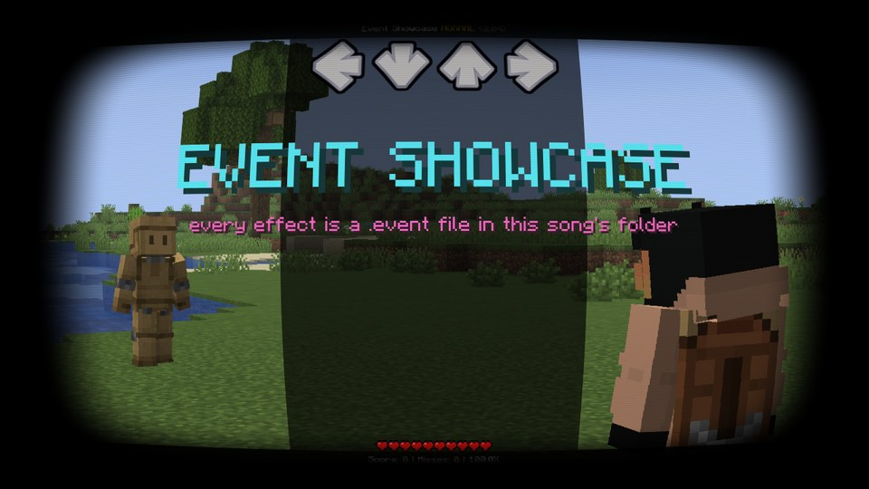

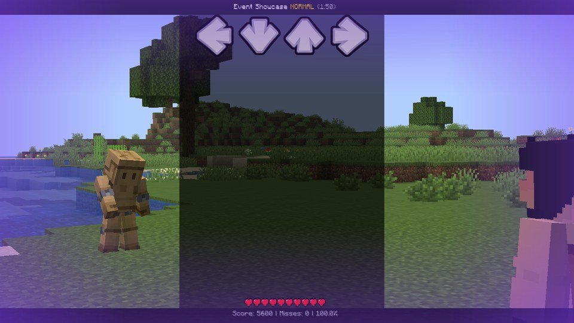

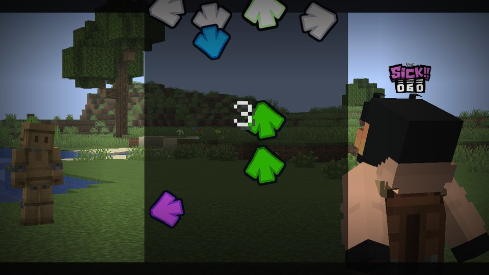

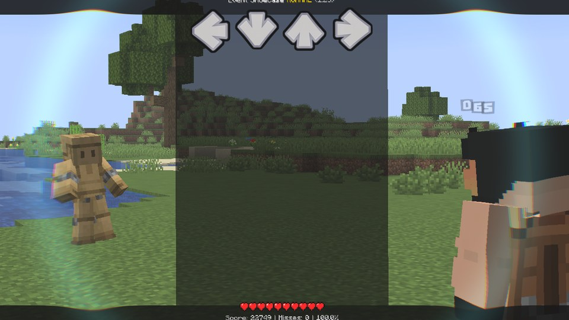

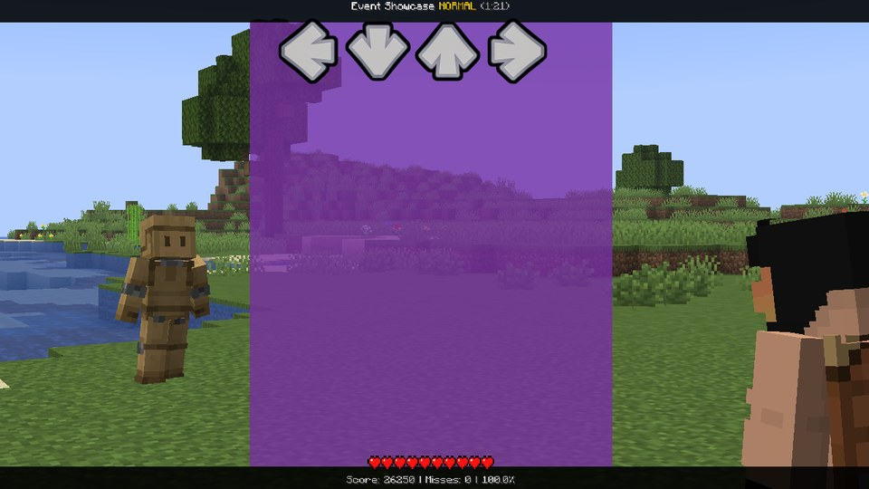

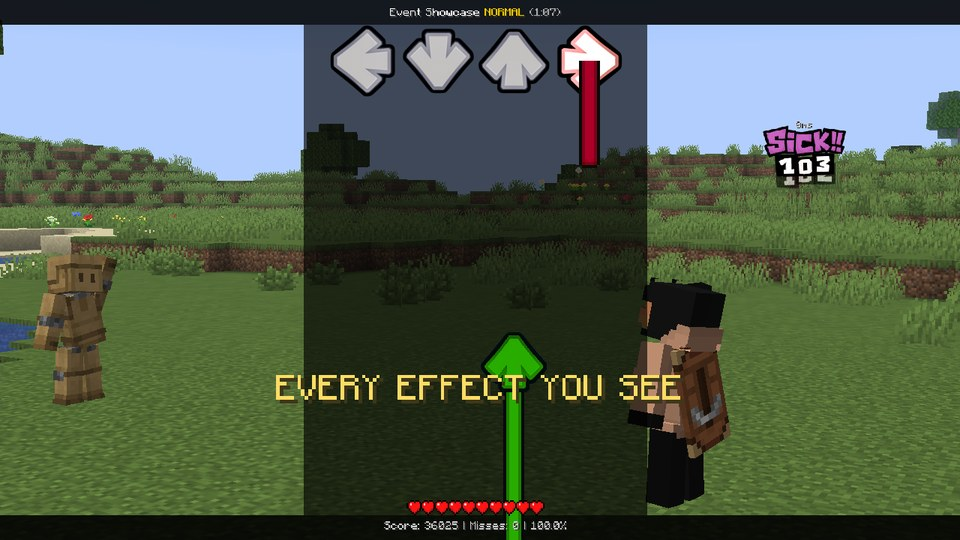

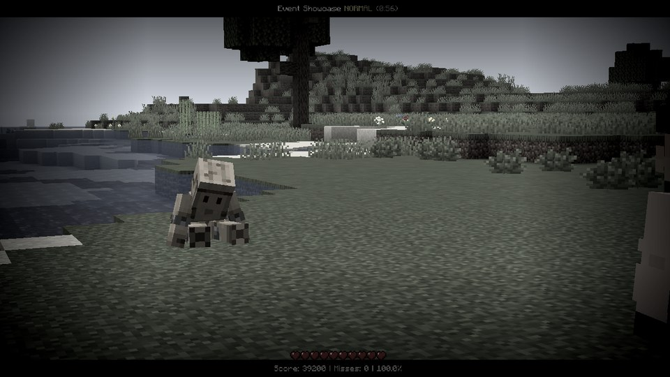

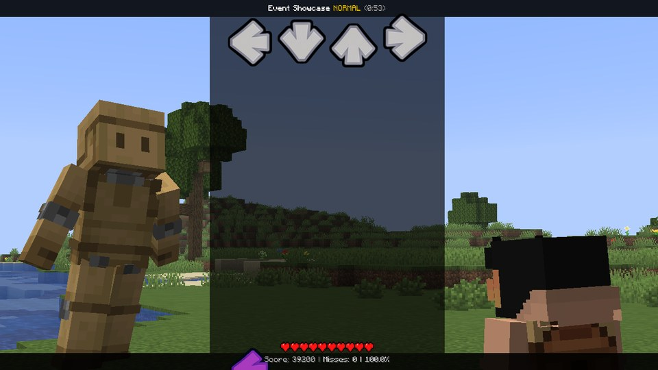

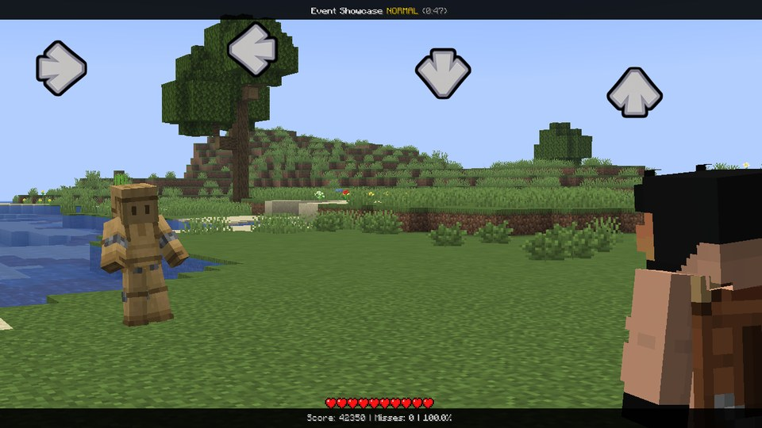

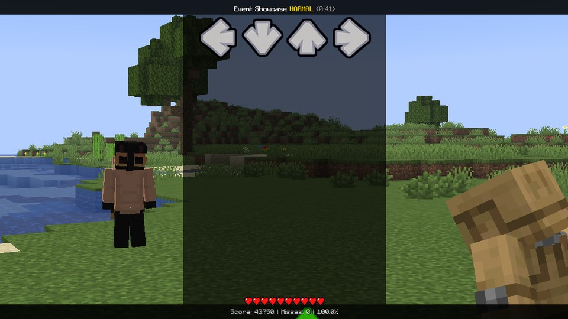

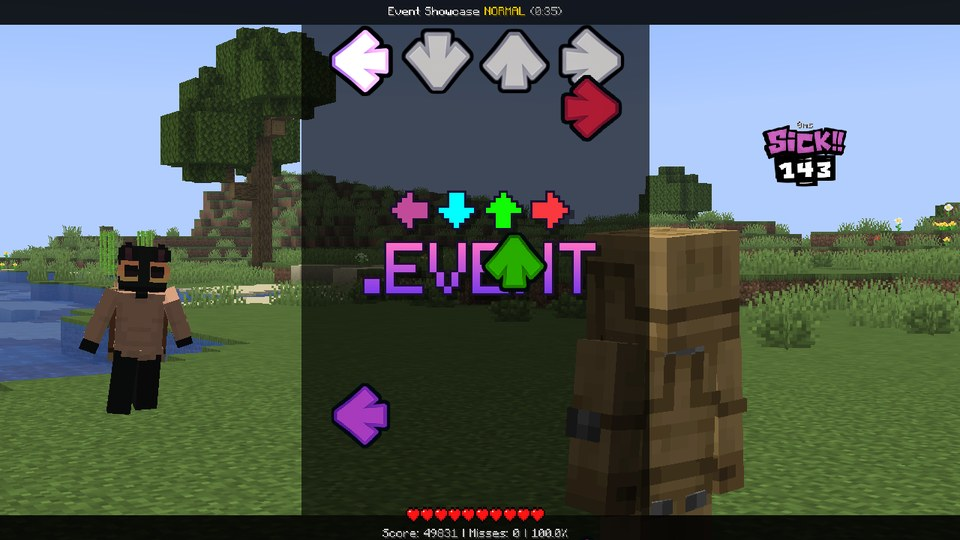

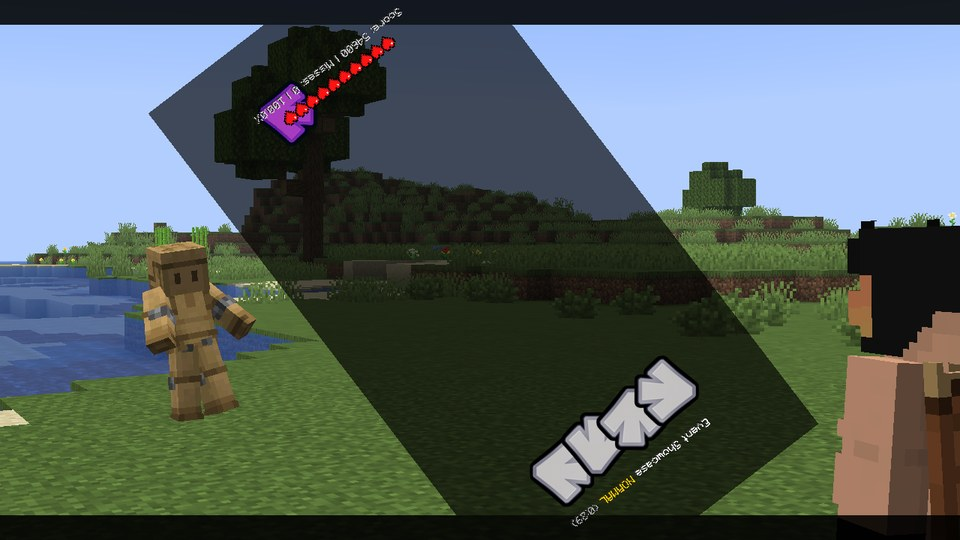

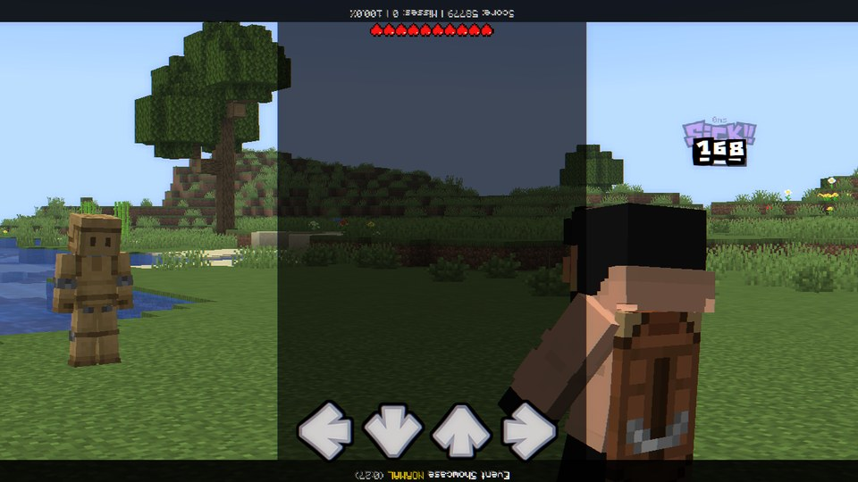

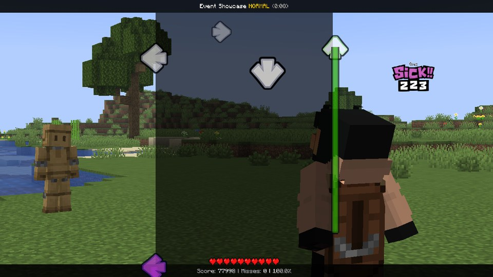

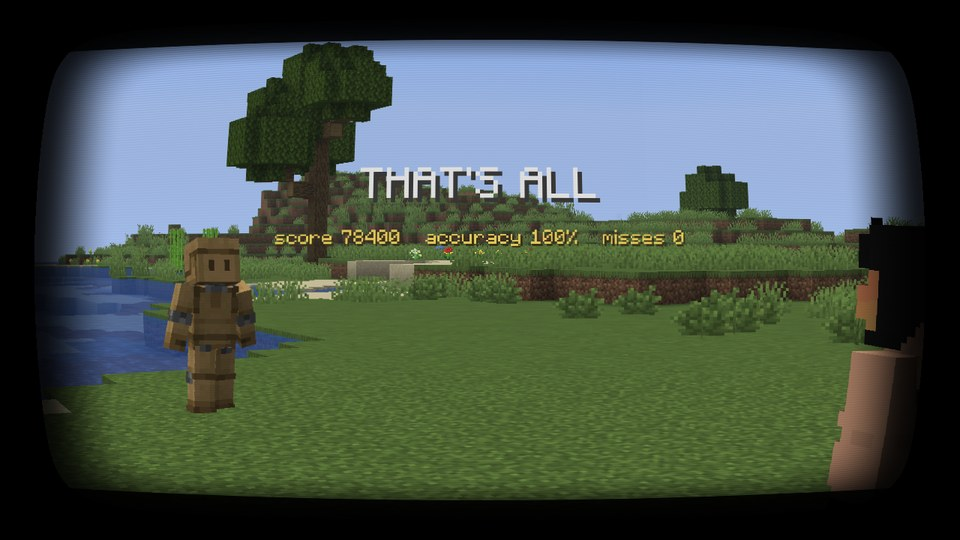

</div>

## The song, part by part

| Part | Bars | What happens |
|---|---|---|
| Intro | 1-4 | The screen switches on like an old TV - a dot, a line, the picture - with the title on it. The playfield starts to drift. |
| Verse 1 | 5-12 | Call and response. The camera follows whoever sings, your hits pop their lanes, your strumline leans toward the opponent's notes, the combo meter shouts at 25. |
| Verse 2 | 13-20 | A spotlight follows the melody, then the lanes get kicked around on the drum pattern. |
| Build | 21-24 | Zoom, dark edges, shake and a 3-2-1. On the opponent's bar the lanes fly off the screen, then they spin. |
| Drop | 25-32 | An impact: a shockwave knocks both fighters back. The playfield punches on the kicks, the strum background lights up, another shockwave, the lanes hop in turns. |
| The dance | 33-40 | Both fighters stop their own animation and dance eight moves, mirrored. The camera swings round them; the words come in one by one. |
| Fake death | 41-44 | The opponent drops dead, the colour drains, the lanes fall off the screen. A heartbeat - then it rises as a giant and the lanes shoot back up. |
| Breakdown | 45-48 | The lanes spread across the whole screen and scroll sideways, wrapping round at the edges. |
| Rebuild | 49-52 | The fighters jump over each other and swap places; two lanes come from the other side. |
| Final drop | 53-68 | Every kick hits the picture, the logo bumps under the notes, the fighters swap back. The playfield turns upside down for four bars - the world stays upright - and back. Then a swap ping-pong. |
| Outro | 69-72 | The lanes ride a ring, then drop out of it. The live score - and the TV switches off. |

Notice how the wildest moves (the lanes off the screen, the playfield turning over) only happen on bars where the
opponent sings? That's on purpose - nobody has to play through them. And every effect keeps to its own property
("channel") or its own bars, so they stack without fighting each other - see [strum[lane]](../api/strum.md).

## What each file shows

Looking for an example of something specific? Find it here, then open that file:

| File | Part of the song | Shows |
|---|---|---|
| `power_on.event` | intro | a song shader (`shaders/crt.fsh`) driven by its four numbers: a dot, a line, the picture; the title on the `"top"` layer |
| `caption.event` | every part | a counter kept for the whole song, a newer caption cancelling an older one's slide-out |
| `cam_sway.event` | from the intro on | `onFrame(dt)`, `noise()`, easing a variable by hand, reading `shared hype` |
| `judge_glow.event` | from verse 1 on | `onHit` / `onMiss`, `note.judgment` / `note.offset`, a function that returns a value |
| `cam_follow.event` | verse 1 on | `onHit` / `onOpponentHit` easing `camera.z` / `.x` / `.yaw` toward whoever sings (fights) |
| `opponent_echo.event` | verse 1 | `onOpponentHit`, lanes turned into directions, a vignette pulse |
| `combo_meter.event` | the whole song | a song script: no chart event, only `onHit` / `onMiss` and `player.combo` |
| `spotlight.event` | verse 2 | `onHit` and `onOpponentHit` sharing one function, `strum[lane].alpha` per lane |
| `jiggle.event` | verse 2, the drops | a modchart's kick: `wobbleX` / `wobbleY` jolted on a drum pattern from `onStep(n)` |
| `build_up.event` | build | `onStep` patterns that speed up, a 3-2-1 scheduled in a `for` loop, writing `shared hype` |
| `kade_sway.event` | build | `.x` / `.y` from `sin()` every frame; "wild" takes `tan()`, so the lanes fly off the screen and come back |
| `spin.event` | build, the end | `.angle` from 360 to 0: once or every bar, counted from where the event sits |
| `the_drop.event` | both drops | an impact, kick / snare patterns in `onBeat`, `hsv()` colours, `hud.angle` |
| `shockwave.event` | every impact | a shader (`shaders/shockwave.fsh`) handed its start time; the fighters' `pitch` / `squash` / `z` |
| `lane_lights.event` | drop | the strum background (`underlay.color` / `.alpha` / `.width`) flaring on the beat |
| `hop.event` | drops | `max(0, sin())` as a bouncing ball, `isDown` to hop toward the middle |
| `dance_routine.event` | the dance | `animate = false`, body parts, eight moves as functions, a mirror flag, `puppet[i]` |
| `orbit_cam.event` | the dance | `camera.x / .y / .z / .yaw / .pitch` together: circling the fighters |
| `word_by_word.event` | the dance | six parameters from the parts of one value, `after()` keeping each step, `break` |
| `fake_death.event` | fake death | `opponent.pose = "death"`, `fx.saturation` draining the colour, the camera looking down |
| `drop_out.event` | fake death | a sequence of tweens per lane with `after()`: fall off, come back with `"elasticOut"` |
| `rise.event` | fake death | `opponent.scale` with `"elasticOut"`, a white flash, the colour back |
| `scroller.event` | breakdown | the lanes across `screen.width`, wrapping round with `%`; an ease written by hand |
| `switcheroo.event` | rebuild, final drop | the fighters jump and swap places: `.x` / `.z` in the fight's frame, `.turn` 180 |
| `scroll_twist.event` | rebuild | text properties (`strum[lane].scroll`), `player.downscroll` |
| `kick_hit.event` | final drop | `fx.chromatic` + `fx.bloom` on every beat |
| `logo_bump.event` | final drop | the song's `logo.png` on the `"lanes"` layer: on the strum background, under the notes |
| `upside_down.event` | final drop | `hud.angle` 180 with `camera.roll` -180 so the world stays upright, the lanes mirrored with `strums.spacing` |
| `halo.event` | outro | `.x` / `.y` / `.scale` / `.alpha` from one angle per lane: a ring with depth |
| `finale.event` | outro | live `player.score` / `player.accuracy` on the `"top"` layer, `onEnd` |
| `power_off.event` | the end | the same shader played backwards, ending on `screen.color` |

## The files

All of them, in the order the song shows them (each file's first comment line has the same number).

??? example "power_on.event"

    ```lua
    --8<-- "event-showcase/events/power_on.event"
    ```

??? example "shaders/crt.fsh"

    ```glsl
    --8<-- "event-showcase/shaders/crt.fsh"
    ```

??? example "caption.event"

    ```lua
    --8<-- "event-showcase/events/caption.event"
    ```

??? example "cam_sway.event"

    ```lua
    --8<-- "event-showcase/events/cam_sway.event"
    ```

??? example "judge_glow.event"

    ```lua
    --8<-- "event-showcase/events/judge_glow.event"
    ```

??? example "cam_follow.event"

    ```lua
    --8<-- "event-showcase/events/cam_follow.event"
    ```

??? example "opponent_echo.event"

    ```lua
    --8<-- "event-showcase/events/opponent_echo.event"
    ```

??? example "combo_meter.event"

    ```lua
    --8<-- "event-showcase/events/combo_meter.event"
    ```

??? example "spotlight.event"

    ```lua
    --8<-- "event-showcase/events/spotlight.event"
    ```

??? example "jiggle.event"

    ```lua
    --8<-- "event-showcase/events/jiggle.event"
    ```

??? example "build_up.event"

    ```lua
    --8<-- "event-showcase/events/build_up.event"
    ```

??? example "kade_sway.event"

    ```lua
    --8<-- "event-showcase/events/kade_sway.event"
    ```

??? example "spin.event"

    ```lua
    --8<-- "event-showcase/events/spin.event"
    ```

??? example "the_drop.event"

    ```lua
    --8<-- "event-showcase/events/the_drop.event"
    ```

??? example "shockwave.event"

    ```lua
    --8<-- "event-showcase/events/shockwave.event"
    ```

??? example "shaders/shockwave.fsh"

    ```glsl
    --8<-- "event-showcase/shaders/shockwave.fsh"
    ```

??? example "lane_lights.event"

    ```lua
    --8<-- "event-showcase/events/lane_lights.event"
    ```

??? example "hop.event"

    ```lua
    --8<-- "event-showcase/events/hop.event"
    ```

??? example "dance_routine.event"

    ```lua
    --8<-- "event-showcase/events/dance_routine.event"
    ```

??? example "orbit_cam.event"

    ```lua
    --8<-- "event-showcase/events/orbit_cam.event"
    ```

??? example "word_by_word.event"

    ```lua
    --8<-- "event-showcase/events/word_by_word.event"
    ```

??? example "fake_death.event"

    ```lua
    --8<-- "event-showcase/events/fake_death.event"
    ```

??? example "drop_out.event"

    ```lua
    --8<-- "event-showcase/events/drop_out.event"
    ```

??? example "rise.event"

    ```lua
    --8<-- "event-showcase/events/rise.event"
    ```

??? example "scroller.event"

    ```lua
    --8<-- "event-showcase/events/scroller.event"
    ```

??? example "switcheroo.event"

    ```lua
    --8<-- "event-showcase/events/switcheroo.event"
    ```

??? example "scroll_twist.event"

    ```lua
    --8<-- "event-showcase/events/scroll_twist.event"
    ```

??? example "kick_hit.event"

    ```lua
    --8<-- "event-showcase/events/kick_hit.event"
    ```

??? example "logo_bump.event"

    ```lua
    --8<-- "event-showcase/events/logo_bump.event"
    ```

??? example "upside_down.event"

    ```lua
    --8<-- "event-showcase/events/upside_down.event"
    ```

??? example "halo.event"

    ```lua
    --8<-- "event-showcase/events/halo.event"
    ```

??? example "finale.event"

    ```lua
    --8<-- "event-showcase/events/finale.event"
    ```

??? example "power_off.event"

    ```lua
    --8<-- "event-showcase/events/power_off.event"
    ```

## The music

Two simple synth leads play the melodies: a hollow square wave for you, and a nasal pulse for the opponent. They're
the song's two vocal tracks, so a miss mutes your lead.

The music, both leads, the chart and the logo were made with a script; the event files and the shaders are written by
hand.
