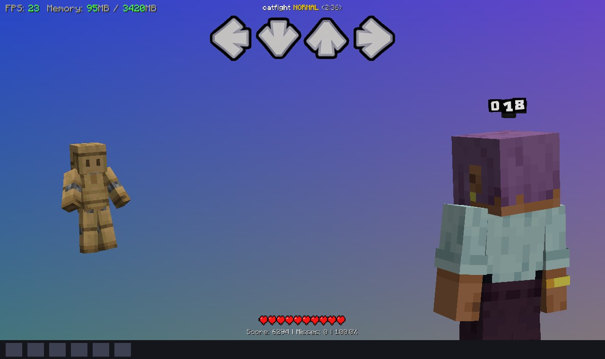
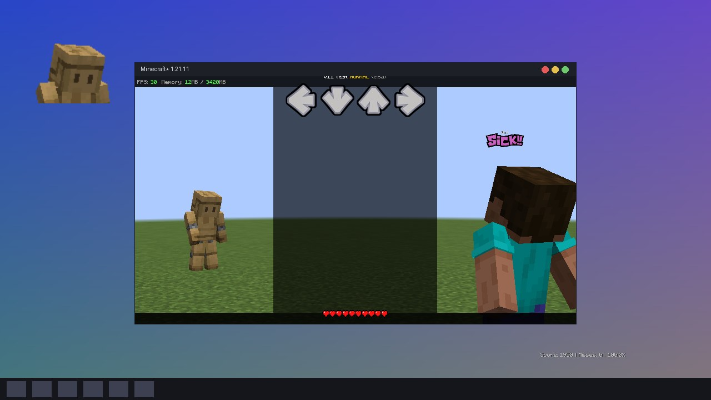
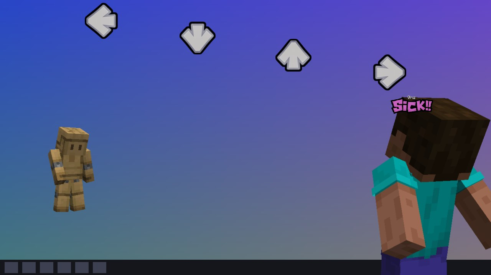

# The game window and pop-out windows

This is the one that makes people go "wait, how?". A song can reach out of the game: shake the whole window on a
miss, make it jump on the drop, shrink it, take its border away. It can play **on the desktop** - the world
disappears, your wallpaper shows through, and only the fighters, the arrows and the HUD are left floating over it.
And it can put pieces of the game into **pop-out windows** of their own: borderless, see-through and always on top,
anywhere on the screen.



*A song with a three-line song script ([below](#the-song-on-the-desktop)): `window.transparent = true`, and the
player keeps playing like always.*

!!! info "Only on the player's own screen, only while the song plays"
    Nobody else sees any of it. On pause, at the end of the song and when it's closed, everything goes back to where
    it was - nobody's desktop is left in a mess. And a player who doesn't want any of this can switch it off under
    **Options › MineFunkin › Window & desktop › Let songs use windows**: then nothing on this page does anything,
    and everything stays in the game window. That page also tells you what works on your system.

## Three things to know first

There are three different things going on, and it helps to keep them apart:

- **The game window** is Minecraft's own window. `window.x`, `window.width`, `window.border`, ... move
  and change it. Every value starts at "as it was when the song started", so `window.x = 20` means "20
  pixels to the right of where it was".
- **The song on the desktop** is still that one game window - only the world in it turns see-through
  (`window.transparent`, Windows). The keys, Esc and the pause work as always.
- **A pop-out** is an extra window that shows the parts of the game you name: `popout[0].show =
  "strums"`. There are eight of them, `popout[0]` to `popout[7]`. A part shown in a pop-out is taken out
  of the game window, so it isn't there twice.

## The song on the desktop

```lua
format 1.1

event { name = "Desktop Mode" }

function onStart()
    window.transparent = true   -- the world goes, the desktop shows through
    window.fill = "desktop"     -- over the desktop above the taskbar (without it: the whole monitor)
    underlay.alpha = 0          -- bare arrows, no dark strip behind the lanes
end
```

Yes, that's the entire script behind the picture at the top. From the song's start, the world disappears and your
desktop shows through the game window. Everything the song draws stays, right where it was: the fighters (in a fight -
in practice, the puppets next to the lanes), the lanes, the HUD, the judgments, your scripts' texts and pictures.
Meanwhile the window quietly covers the monitor without a frame - it's never real full screen.

What happens when ...

| | |
|---|---|
| **Keys, Esc** | As always - it's the game window. |
| **A click on the desktop** (or Alt+Tab) | The click goes through to the desktop and the game loses the keyboard: in practice and against the dummy the song **pauses**; against a player it goes on (nobody wants a pause request on every click) - click back into the song to play on. |
| **Pause** | The pause screen covers the whole monitor. Resume, and the desktop is back. |
| **End of the song** | The window goes home. |

A few things worth knowing:

- Whatever the song draws shows - over the desktop it's simply solid: the strip behind the lanes
  (`underlay.alpha = 0` takes it away), a flash, the screen colours, the vignette. The cinematic bars of
  a fight are left out.
- [Effects](effects.md) on the `"screen"` target change only what's drawn, the desktop stays clear.
  `"world"` and `"terrain"` effects have no world to change.
- **Only on Windows.** Elsewhere nothing changes (the world stays) and the [event log](../help/troubleshooting.md#the-event-log)
  says so once. Replays keep their arena.
- How does it work? Windows can let one colour shine through a window (`#131313`, almost black). MineFunkin paints
  exactly the desktop part in that colour. Anything else that happens to be that exact colour (say, a dark skin in
  the light) gets nudged one invisible step off it, so nothing of the song can turn into a hole.

## Your first pop-out

```lua
format 1.1

event { name = "Lanes Out" }

function onEvent(p)
    popout[0].show = "strums"                      -- your four lanes get a window of their own
    tween(popout[0].x, 400, beats(2), "sineInOut") -- ... and it slides 400 pixels to the right
    after(beats(8), function()
        resetWindow(beats(1))                      -- flies home and closes
    end)
end
```

The pop-out opens **exactly on top of where its parts were** in the game window, at the same size - so at first,
nothing seems to happen. Then it slides out: past the edge of the game window, onto the desktop, with the notes still
coming. Then `resetWindow(beats(1))` glides it home and closes it, and the lanes seem to fly back in. It looks like
magic, and it's eight lines.

## What a pop-out can show

`popout[n].show` is a list of parts, separated by spaces, commas or `+`: `"left right"`,
`"player, judgments"`, `"score+health"`. `""` closes the pop-out.

| Part | |
|---|---|
| `strums` | Your four lanes: receptors, notes, holds. |
| `left`, `down`, `up`, `right` | One of your lanes (`lane0` ... `lane3` work too). |
| `opponentStrums` | The opponent's receptor row (practice). |
| `player`, `opponent` | A fighter (see [Fighters in a pop-out](#fighters-in-a-pop-out)). |
| `judgments` | The "Sick!" popup, the ms label and the combo. |
| `score`, `title`, `health` | The score line, the song title, the hearts. `hud` is all three. |
| `text0` ... `text7`, `image0` ... `image31` | One of the scripts' [texts](../api/text.md) and [pictures](../api/image.md). |

One pop-out can show several parts - it's then as big as all of them together (`"left right"` spans all four
lanes). Everything about a part keeps working inside its pop-out: lane offsets, colours and scroll directions, a
fighter's skin and pose, the judgments' size. The lanes and the HUD even zoom, bump, bounce and shake exactly like in
the game window, so a pop-out sitting at home matches the game pixel for pixel.

Typo in a part (`popout[0].show = "lefft"`)? That's an error when the file loads, with a friendly "did you mean
left?".

## Moving and sizing a pop-out

A pop-out is placed and sized by [`popout[n].x`, `.y`, `.width`, `.height`, `.zoom`, `.cropX`, `.cropY`,
`.alpha` and `.keep`](../api/popout.md) - each with its default and range on the [popout](../api/popout.md) page.

**Putting a pop-out at a fixed spot on the screen.** `x` and `y` are offsets from home, so to put a pop-out's middle
at a certain spot of the monitor, subtract its home:

```lua
-- The middle of popout[0] 150 pixels from the monitor's top left corner.
popout[0].x = monitor.x + 150 - popout[0].homeX
popout[0].y = monitor.y + 150 - popout[0].homeY
```

`monitor.x`, `monitor.y`, `monitor.width` and `monitor.height` are the monitor the game is on, in
pixels (read only).

**A cut-out.** A small `width` / `height` shows only part of what the pop-out would show; `cropX` / `cropY` move the
view inside it, and `zoom` enlarges it. That's how you get a facecam:

```lua
-- The opponent's head as a small window in the top left corner of the screen.
popout[0].show = "opponent"
popout[0].keep = true           -- it stays in the world too
popout[0].width = 190
popout[0].height = 150
popout[0].zoom = 1.8
popout[0].cropY = -85           -- look further up: at the head

-- in onFrame, so it stays there:
popout[0].x = monitor.x + 130 - popout[0].homeX
popout[0].y = monitor.y + 110 - popout[0].homeY
```

The right `cropY` depends on the zoom and on how big the game window is (a bigger window draws the fighter bigger).
Try it with the window size your players will likely have, and check that the head stays in the frame.



## Fighters in a pop-out

In a **fight** (at a Speaker), `player` and `opponent` are the actual fighters from the world: the 3D model with its
armour, skin and pose, every [`player.*` effect](fighters.md) included - cut out of the world and drawn into the
pop-out on a see-through background. While it's popped out, it's gone from the world (unless you set `keep`).

| `popout[n].view` | |
|---|---|
| `"full"` (default) | The whole fighter, legs and feet too, as the fight camera sees it. |
| `"camera"` | Exactly what the screen shows of it. Your own fighter stands right in front of the camera, so it's cut off at the bottom edge - put that edge on the taskbar and it seems to stand on it. |

In **practice** (the Retro TV) and in replays there's no world, so `player` and `opponent` are the puppets next to
the lanes.



## The game window

The window itself: [`window.x`, `.y`, `.width`, `.height`, `.fullscreen`, `.border`, `.alpha`, `.title`,
`.fill`](../api/window.md) - and read-only answers like `window.status`, `window.canPlace` - all on the
[window](../api/window.md) page.

```lua
-- The window shakes on every miss.
function onMiss(n)
    window.x = 14
    tween(window.x, 0, beats(0.5), "elasticOut")
end
```

```lua
-- The window jumps on the drop and the title changes.
function onEvent(p)
    window.title = "DROP!"
    window.y = -60
    tween(window.y, 0, beats(1), "bounceOut")
end
```

Some safety rails, so a song can't make the game unusable: the window never leaves the monitor completely (at least
64 pixels stay on it, and the title bar stays reachable), full screen flips at most once a second, and the size
changes at most 30 times a second. Every size change rebuilds the game's picture, so don't tween `width` / `height`
every frame for long.

## Putting it back: `resetWindow`

```lua
resetWindow()            -- the game window back, every pop-out closed - at once
resetWindow(beats(2))    -- the window and the pop-outs glide home first, then the pop-outs close
```

A pop-out at home sits exactly over its parts' place, so with a duration they seem to fly back into the game. The
song's end, a pause and closing the song all do this by themselves too.

## Where it works

Not every system lets a program do all of this:

| | |
|---|---|
| Windows | Everything. |
| macOS | Everything but `window.transparent` (the world stays). |
| Linux with X11 | Everything but `window.transparent`. A pop-out's see-through background needs a compositor (most desktops have one); without one it has a black background. |
| Linux with Wayland | No program may place its own windows there: the pop-outs stay off (`popout[n].open` is false) and `window.x` / `window.y` / `window.alpha` do nothing. Size, full screen and the title work; `window.transparent` doesn't. |

The [event log](../help/troubleshooting.md#the-event-log) says once when something isn't possible on this computer.
A script can also check `popout[n].open` and do something else instead.

## Good to know

- Clicks go through a pop-out to whatever is under it, and the keyboard stays with the game window. For a whole song
  on the desktop, use [`window.transparent`](#the-song-on-the-desktop) - one window, nothing to keep in step.
- With a shader pack (Iris), a fighter in a pop-out is drawn with Minecraft's own look, not the pack's -
  the pack only draws the world.
- Each pop-out costs about as much as drawing its parts once more. A fighter in a pop-out is drawn once,
  into its pop-out instead of the world (twice with `keep`).
- At most eight pop-outs, each at most 4096 pixels a side.
- If your players stream or record: a pop-out is a real window, so capturing only the game window misses it - a
  display capture gets it. A window capture of a song on the desktop shows the see-through part in the key colour
  (almost black).
