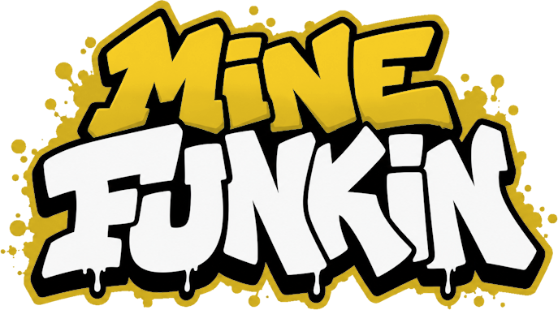
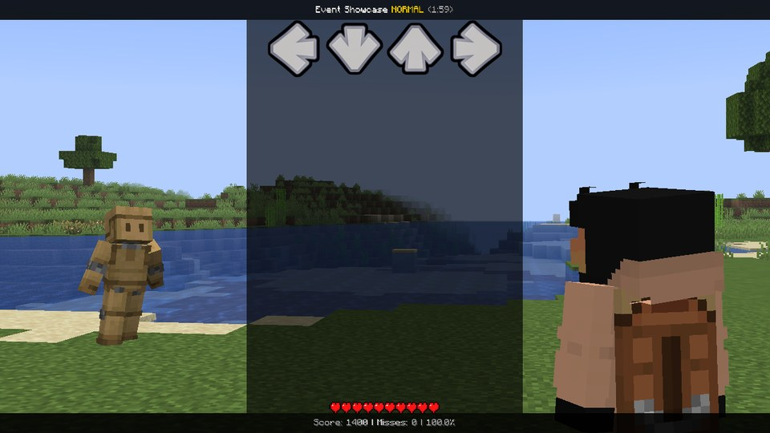

---
hide:
  - navigation
  - toc
---

# MineFunkin Docs { .mf-hidden }

<div class="mf-hero" markdown>

</div>

MineFunkin is a Friday Night Funkin' engine for Minecraft. At a **Speaker** you fight another player or the Dummy,
right in the world, with everybody around watching. At the **Retro TV** you practise songs and make your own charts.



This wiki is about everything *around* the notes: the camera swinging round on the drop, the lanes going upside down,
your opponent turning into a giant, the whole game window shaking on a miss. You can build all of that yourself with
small text files next to your song. You don't need to know Java or any other programming language for it.

Pick where you want to go:

<div class="grid cards mf-cards" markdown>

-   :material-script-text-outline:{ .lg .middle } **Event scripts**

    ---

    Learn to script your songs: flashes, zooms, modcharts, the fight camera, both fighters, stages, effects and
    shaders - even the game window. Small text files, no Java needed.

    [:octicons-arrow-right-24: Start here](guides/index.md) · [Your first event](guides/tutorial.md)

-   :material-book-open-page-variant-outline:{ .lg .middle } **Event API**

    ---

    Look things up: every callback, action, shortcut and function, and one page per property group - each with
    its kind, default, range and an example.

    [:octicons-arrow-right-24: The API](api/index.md) · [Frequently used](api/frequently-used.md)

-   :material-music-box-multiple-outline:{ .lg .middle } **Songs**

    ---

    What's in a song folder, where it goes, how to import one, and the `.mfknsong` and `.mfkn` files.

    [:octicons-arrow-right-24: Songs](songs/index.md)

-   :material-puzzle-outline:{ .lg .middle } **Addon API**

    ---

    For other mods (Java): song results, fights, practice and every note of the local player's runs. Opt-in, on
    the server and the client.

    [:octicons-arrow-right-24: Addon API 1.1](addon-api/index.md) · [Set up your mod](addon-api/setup.md)

</div>

## Not sure where to start?

<div class="mf-wide" markdown>

| You want to ... | Go here |
|---|---|
| make your very first event | [Your first event](guides/tutorial.md) - ten minutes, step by step |
| find out what some name does | the [Event API](api/index.md), or just type it into the search up top |
| make the lanes and notes dance | [Modcharts](guides/modcharts.md) |
| put a stage behind the fighters | [Stages and sprites](guides/stages.md) |
| bring over a song from Psych or Kade | [Coming from Psych](guides/psych.md) · [Coming from Kade](guides/kade.md) |
| get your song files in order | [Songs](songs/index.md) |
| understand an error message | [Errors and fixes](help/troubleshooting.md) |
| hook your own Java mod into MineFunkin | the [Addon API](addon-api/index.md) |
| know what you may share and how | the [License](license.md) |

</div>

## A little taste

Here's a whole event. Drop it into a song's folder as `pop_flash.event`, and the chart editor gets a new event called
**Pop Flash** - with a slider and a colour picker, built from the two lines under `params`:

```lua
format 1.1

event {
    name = "Pop Flash",
    color = #FF6EC7,
    category = "Party",
}

params {
    strength = number { from = "value1", default = 0.05, min = 0, max = 0.3, label = "Zoom pop" },
    tint     = color  { from = "value2", default = #FFFFFF, label = "Flash colour" },
}

function onEvent(p)
    camera.bump += p.strength      -- the camera pops
    flash(p.tint, beats(0.5))      -- a flash in your colour, gone after half a beat
end
```

Place it on a big drum hit and press Space. That's really all it takes.
