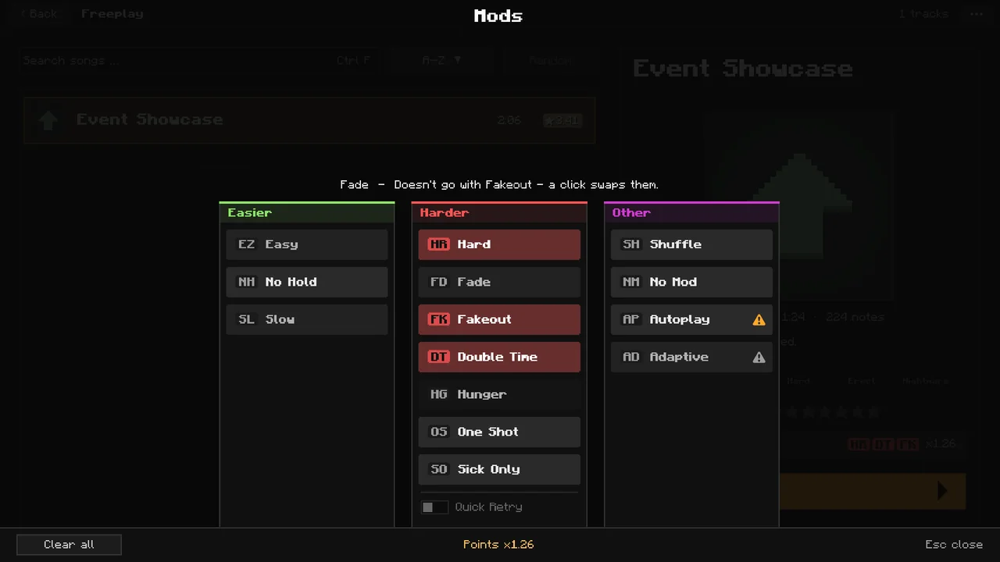

# Mods

Mods change how a song plays: easier, harder, faster, or just different. Every mod changes your **points** too - an
easier mod gives fewer, a harder one more.

## Picking mods

In the song list, click **Mods** above START. Three columns open: **Easier**, **Harder** and **Other**. Click a mod to
switch it on or off; point at it to read what it does. The number at the top is what your points are multiplied by.

- Your mods stay on for every song until you switch them off - or until you restart the game.
- Some mods don't go together. Clicking one of them swaps it for the other:
  Easy and Hard, One Shot and Sick Only, Fade and Fakeout. Only one speed at a time: Double Time, Slow or Adaptive.
- A grey mod can't be used here - point at it to see why.

## All mods

| Mod | | What it does | Points |
|---|---|---|---|
| **Easy** | EZ | Wider timing, gentler on your health. | x0.5 |
| **No Hold** | NH | Every hold note becomes a normal note. | x0.9 |
| **Slow** | SL | Everything 0.75x as fast, the music keeps its pitch. | x0.3 |
| **Hard** | HR | Tighter timing, harsher misses and holds. | x1.06 |
| **Fade** | FD | Notes fade out before they reach you. | x1.06 |
| **Double Time** | DT | Everything 1.5x as fast, the music keeps its pitch. | x1.12 |
| **One Shot** | OS | One miss and you're out. | x1 |
| **Sick Only** | SO | Anything but a Sick and you're out. | x1 |
| **Hunger** | HG | Your health is a hunger bar that keeps sinking (see below). Fights only. | x1.02 |
| **Fakeout** | FK | Now and then an extra note that isn't really there (see below). | x1.06 |
| **Shuffle** | SH | Every note on a random lane. | x1 |
| **No Mod** | NM | The song's modchart stays off. | x0.5 - x1 |
| **Autoplay** | AP | Watch the song played perfectly. Nothing is saved or sent. | - |
| **Adaptive** | AD | The song's speed follows how well you play (see below). | x1 |

**No Mod** takes away more points the more of the song has a modchart: a song that's moving its lanes the whole time
gives x0.5, a song with a short modchart part almost x1.

**Quick Retry** sits below the columns. It only works with One Shot or Sick Only: once you're out, the song starts
again right away.

### Hunger

Your health becomes Minecraft's hunger bar. It sinks **all the time** - in the intro and in breaks too. A full bar
with nothing eaten drops to its last point in 10 seconds. Your hits are the food:

- A **Sick** fills the bar.
- A **Good** gives back a little less than the bar loses - a run of Goods lets it sink slowly.
- A **Bad** gives a tiny bit, a **Shit** nothing.
- Sinking alone never ends your run: the bar stops at its last point. But one miss down there, and it's over.

Sixteen Sicks in a row fill you up for a moment - the bar stops sinking for a short time. Hunger works in fights only;
Freeplay has no health.

### Fakeout

Every 3 to 5 seconds an **extra note** comes that isn't in the chart. It looks like any other note - until it starts
to fade halfway to your arrows. By the time it would reach them, it's gone. Pressing it counts as a miss, so keep
your fingers still. How early it fades follows your scroll speed: it always looks real for the first half of its way.

### Adaptive

The song's speed follows you: hit well and it gets faster, miss and it gets slower - anywhere from 0.75x to 1.75x.
The music keeps its pitch. A soft glow at the edges of the screen shows what's happening:

- **Warm, drifting up** - the song is speeding up.
- **Blue, drifting down** - the song is slowing down.
- **Faint and still** in one of the colours - you're at the top (1.75x) or the bottom (0.75x).

With **Less motion** in the settings the glow doesn't drift.

## Where mods work

| | Mods |
|---|---|
| **Freeplay** (Retro TV) | All but Hunger. |
| **Against the Dummy** | All of them. |
| **Against a player** | All but Autoplay. The host's mods are offered to the other player, who picks "with" or "without" - you both always play the same. |
| **A fight another mod starts** | That mod decides. |

## Ranked and unranked

**Autoplay** and **Adaptive** are unranked - they have an orange warning sign in the menu. A run with them never
becomes a best score and never goes on a leaderboard. A fight with Adaptive still has a winner, and its replay is kept
on your own computer. Autoplay keeps nothing at all.

All other mods are ranked: your run, its rank and its replay are saved with the mods you played, and the server checks
the result with the same mods.
